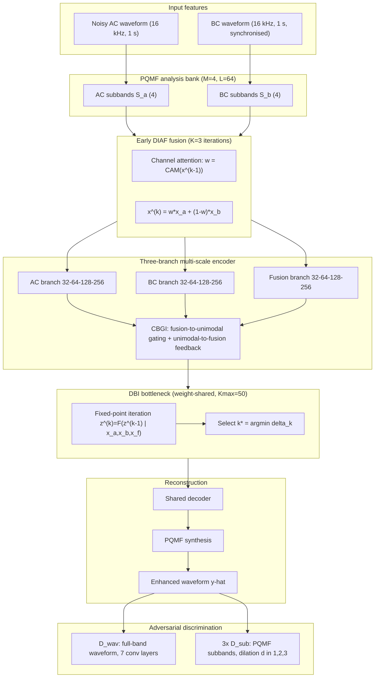

# Wu, Zheng, Zhang, Zhang, Zheng, Yang, Yan & Yin 2026: DBMIF — A Deep Balanced Multimodal Iterative Fusion Framework for AC/BC Speech Enhancement

- **Authors**: [[entities/yilei-wu|Yilei Wu]], [[entities/changyan-zheng|Changyan Zheng]], [[entities/xingyu-zhang|Xingyu Zhang]], [[entities/yakun-zhang|Yakun Zhang]], [[entities/chengshi-zheng|Chengshi Zheng]], [[entities/shuang-yang|Shuang Yang]], [[entities/ye-yan|Ye Yan]], [[entities/erwei-yin|Erwei Yin]]
- **Affiliations**: Defense Innovation Institute, Academy of Military Sciences (AMS), Beijing; Key Laboratory of Noise and Vibration Research, Institute of Acoustics, Chinese Academy of Sciences (Chengshi Zheng)
- **Venue**: Applied Intelligence (Springer)
- **Year**: 2026 (received 9 Nov 2025, accepted 6 Feb 2026, published online 18 Mar 2026)
- **Type**: Journal Article
- **DOI**: [10.1007/s10489-026-07150-z](https://doi.org/10.1007/s10489-026-07150-z)
- **Code**: [github.com/wyl516w/dbmif](https://github.com/wyl516w/dbmif)
- **Zotero**: [Open in Zotero](zotero://select/items/0_9WT5XNQU)

## Summary

DBMIF is a three-branch, [[concepts/time-domain-speech-enhancement|time-domain]] [[concepts/bcs-guided-speech-enhancement|BC-aided speech enhancement]] framework that attacks one specific failure mode of AC/BC fusion: **modality dominance**. Under extreme noise the AC branch carries little usable information, so the noise-robust BC branch produces the larger immediate gradient and effectively collapses the fused representation onto a single modality; DBMIF counteracts this with a coarse-to-fine chain of three balancing mechanisms — an early [[concepts/deep-iterative-attention-fusion|iterative channel-attention fusion]] (DIAF), a multi-scale three-branch encoder–decoder with [[concepts/cross-branch-gated-interaction|bidirectional cross-branch gating]] (CBGI) at every scale, and a parameter-shared [[concepts/deep-balanced-interaction|fixed-point equilibrium bottleneck]] (DBI).

The system operates on 4 subbands of a [[concepts/pseudo-qmf-bank|PQMF]] analysis bank and is trained adversarially against a [[concepts/multi-scale-discriminator|multi-resolution discriminator]] set that scores the full-band waveform plus the same 4 subbands under three dilation factors. On the 100-speaker ABCS corpus it reaches SI-SDR 12.42 dB, PESQ 2.70, STOI 0.90, ESTOI 0.85, DNSMOS 3.35, and cuts downstream ASR CER to 15.84% (Whisper) / 12.07% (WeNet) — the best of nine systems — with an ablation showing the gating module is worth ~6% absolute CER on its own.

## Problem Formulation

PQMF subband signal model. For modality $c \in \{a, b\}$ (air / bone), the $m$-th subband is the convolution of the modality waveform with the analysis filter $h_m$:

$$
\mathrm{s}_{c,m}[n] = (\mathrm{x}_c * h_m)[n], \qquad m \in \{0, \dots, M-1\}
$$

Analysis and synthesis filters are the Kaiser-windowed-sinc modulated pair derived from a prototype $p[n]$ of length $L$:

$$
h_m[n] = 2\,p[L-1-n]\cos\!\left[\frac{(2m+1)\pi}{2M}\left(n-\frac{L-1}{2}\right) + (-1)^m \frac{\pi}{4}\right],
$$
$$
g_m[n] = 2M\,p[n]\cos\!\left[\frac{(2m+1)\pi}{2M}\left(n-\frac{L-1}{2}\right) - (-1)^m \frac{\pi}{4}\right]
$$

with $M = 4$ subbands and prototype length $L = 64$. The network estimates all clean subbands jointly from both modalities' subband stacks, $\hat{\mathrm{S}} = f_{\boldsymbol{\theta}}(\mathrm{S}_a, \mathrm{S}_b)$, and the waveform is resynthesised by $\hat{\mathrm{y}}[n] = \sum_{m=0}^{M-1} (\hat{\mathrm{s}}_m * g_m)[n]$. Training minimises $\min_{\boldsymbol{\theta}} \mathcal{L}(\mathrm{y}, \hat{\mathrm{y}})$.

**Why subbands and not plain full-band waveform?** The frequency-dependent behaviour of BC speech (roll-off above ~1 kHz, propagation-path colouration, temporal misalignment from transducer–skin contact) is better matched by a decomposition that gives the fusion mechanism a frequency axis to act on. Section 5.2.3 confirms the payoff: the learned AC-vs-BC weight is systematically low in the lowest subband (pitch anchored on BC) and high in the upper subbands (high-frequency detail from AC).

**Modality-dominance mechanism (the paper's core motivation)**: at low training SNR the AC branch's targets are effectively unlearnable, so only the BC branch yields substantial loss reduction; its gradients dominate the shared fusion stream, the representation collapses onto one modality, and the fusion machinery becomes dead weight. Single-stage fusion cannot recover from this because after the sole fusion junction there is no further cross-modal exchange.

## Methodology

The pipeline is: PQMF analysis → early DIAF fusion of AC/BC → three-branch multi-scale encoder–decoder with CBGI at each stage → DBI equilibrium bottleneck → decoder → PQMF synthesis, trained adversarially against $D_{\mathrm{wav}}$ and three $D_{\mathrm{sub}}$ copies.

### Model Structure, Inputs, and Outputs

**Encoder block widths**: progressive channels $\{32, 64, 128, 256\}$ per stage, identical for all three branches; the AC and BC branches preserve modality-specific discriminative features while the central fusion branch carries the exchange.

#### Generator modules (one network, three interacting branches)

| Element | Specification |
|:--------|:--------------|
| **CBGI — fusion-to-unimodal modulation** | $g_{fa}^{(s)} = \sigma(\mathcal{F}_{\mathrm{conv}}(\mathrm{x}_f^{(s)}))$, $\tilde{\mathrm{x}}_a^{(s)} = g_{fa}^{(s)} \odot \mathcal{F}_{\mathrm{conv}}(\mathrm{x}_a^{(s)})$ (same for $b$); sigmoid gates from independent $1\times1$ convs suppress irrelevant components in the unimodal branches using fusion-stream global context. |
| **CBGI — unimodal-to-fusion feedback** | $g_a^{(s)} = \sigma(\mathcal{F}_{\mathrm{conv}}(\mathrm{x}_a^{(s)}))$, $\hat{\mathrm{x}}_{af}^{(s)} = g_a^{(s)} \odot \mathcal{F}_{\mathrm{conv}}(\mathrm{x}_f^{(s)})$ (same for $b$), then $\tilde{\mathrm{x}}_f^{(s)} = \hat{\mathrm{x}}_{af}^{(s)} + \hat{\mathrm{x}}_{bf}^{(s)}$ — the fusion stream is re-gated by each modality, closing the loop. |
| **DIAF initialisation** | $\mathbf{x}^{(0)} = \mathbf{x}_a^{(0)} + \mathbf{x}_b^{(0)}$ — parameter-free neutral start. |
| **DIAF iteration** | $\mathrm{w}^{(k)} = \mathrm{CAM}(\mathrm{x}^{(k-1)}) \in \mathbb{R}^C$, then $\mathrm{x}^{(k)} = \mathrm{w}^{(k)} \odot \mathrm{x}_a^{(0)} + (1-\mathrm{w}^{(k)}) \odot \mathrm{x}_b^{(0)}$. $w$ = per-channel confidence in **AC**; $K = 3$ iterations chosen empirically. Output $\mathbf{x}_f^{(0)} = \mathbf{x}^{(K)}$. |
| **DBI state update** | $(\mathrm{z}_a^{(k)}, \mathrm{z}_b^{(k)}, \mathrm{z}_f^{(k)}) = \mathcal{F}(\mathrm{z}_a^{(k-1)}, \mathrm{z}_b^{(k-1)}, \mathrm{z}_f^{(k-1)} \mid \mathrm{x}_a, \mathrm{x}_b, \mathrm{x}_f)$: stage 1 intra-modal refinement of $\mathrm{z}_a,\mathrm{z}_b$ guided by their own bottleneck inputs; stage 2 fusion feedback integrating the refined unimodal states plus $\mathrm{z}_f^{(k-1)}$ under guidance of $\mathrm{x}_f$. |
| **DBI convergence / stopping** | $\delta_k = \lVert \mathrm{z}^{(k)} - \mathrm{z}^{(k-1)} \rVert_F$, $k^\star = \arg\min_{2 \le k \le K_{\max}} \delta_k$, $\mathrm{z}^\star = \mathrm{z}^{(k^\star)}$; $K_{\max} = 50$. Batch and temporal dimensions are merged so each frame is treated as an independent sample. |
| **Parameter sharing** | $\mathcal{F}$ is reused across all iterations (deep-equilibrium style) — refinement depth costs no parameters; CBGI gates use $1\times1$ convolutions only. |

#### Discriminators

| Network | Structure | Input | Output | Role |
|:--------|:----------|:------|:-------|:-----|
| $D_{\mathrm{wav}}$ | 7 conv layers: 1→16 (k15,s1), 16→64 (k41,s4,g4), 64→256 (k41,s4,g4), 256→1024 (k41,s4,g4), 1024→1024 (k41,s4,g4), 1024→1024 (k5,s1), 1024→1 (k3,s1) | Raw full-band waveform at 16 kHz (real or generated) | Time-indexed scalar logit map | Global structural coherence and low-frequency consistency |
| $D_{\mathrm{sub}}$ ×3 | 8 conv layers: 4→36 (k3,s1,g4), 36→72 (k7,s2,g4), 72→144 (k7,s2,g4), 144→288 (k7,s2,g4), 288→576 (k7,s2,g4), 576→1152 (k7,s2,g4), 1152→1152 (k5,s1,g4), 1152→1 (k3,s1); three copies with dilation $d \in \{1,2,3\}$ | The same 4 PQMF subbands (analysed from real or generated speech), concatenated channel-wise | Logit map per subband stack | Fine-grained spectral fidelity at multiple periodicities |

All discriminator convolutions use weight normalisation and Leaky-ReLU ($\alpha = 0.1$) except the linear output layer.

**Generator input / output summary**

| Item | Value |
|:-----|:------|
| Input | 1-second synchronised AC and BC waveform segments, 16 kHz, noise injected into the **AC channel only** |
| Domain | Time domain (4 PQMF subbands, $M=4$, $L=64$) |
| Output | Enhanced full-band waveform (PQMF-synthesised) |
| Losses | Hinge adversarial + feature matching ($\lambda = 1000$) |
| Training data | ABCS corpus (Wang et al. 2022): 100 speakers, 47,182 utterances, 42 h, 16 kHz |

### Training Losses

Discriminator loss is a hinge objective summed over the full-band discriminator and the three subband discriminators ($k = 0,\dots,3$):

$$
L_D = \sum_{k=0}^{3}\Big[\mathbb{E}_{\mathrm{y}}\big[\max(0, 1 - D_k(\mathrm{y}))\big] + \mathbb{E}_{\hat{\mathrm{y}}}\big[\max(0, 1 + D_k(\hat{\mathrm{y}}))\big]\Big]
$$

Generator adversarial term:

$$
L_G^{\mathrm{adv}} = \sum_{k=0}^{3}\mathbb{E}_{\hat{\mathbf{y}}}\big[\max(0, 1 - D_k(\hat{\mathbf{y}}))\big]
$$

Feature-matching term (L1 distance between discriminator intermediate features, normalised per layer):

$$
L_G^{\mathrm{fm}} = \sum_{k=0}^{3}\sum_{i=1}^{N_k-1}\frac{1}{M_i}\big\lVert D_k^{(i)}(\mathrm{y}) - D_k^{(i)}(\hat{\mathrm{y}})\big\rVert_1
$$

Total generator objective:

$$
L_G = L_G^{\mathrm{adv}} + \lambda L_G^{\mathrm{fm}}, \qquad \lambda = 1000
$$

Notes: no explicit spectral or waveform reconstruction loss is reported — structural fidelity rests entirely on the discriminator stack plus feature matching, in the MelGAN tradition, with the subband discriminators supplying the fine spectral supervision that full-band discriminators under-provide. Generator and discriminator are updated **alternately** (not jointly in a single backward pass).

## Experimental Setup

| Item | Setting |
|:-----|:--------|
| Dataset | Air- and Bone-Conducted Synchronized Speech corpus (ABCS, Wang et al. 2022): 100 speakers, 47,182 utterances, 42 h, 1–5 s, 16 kHz |
| Training noise | DNS Challenge + UTD Environmental Noise (machinery, in-car, babble); **AC channel only** |
| Training SNR | Uniformly sampled from **[−15, 5] dB** |
| Training pipeline | Online slicing to 1-s windows, per-segment noise mixing, RMS rescaling to the clean speech, 50 ms linear fade-in/out |
| Test noise | QUT-NOISE (café, car), NOISEX-92 (industrial/military), Nonspeech (everyday ambient); unseen during training |
| Test SNR | Fixed set {−15, −10, −5, 0, 5} dB; full-length utterances, no segmentation |
| Optimiser | Adam, lr $3\times10^{-4}$, $(\beta_1, \beta_2) = (0.5, 0.9)$, cosine annealing |
| Batch / epochs | 32 / 100 |
| Loss weighting | Feature-matching $\lambda = 1000$ |
| Metrics | SI-SDR, PESQ, STOI, ESTOI, DNSMOS (P.835-style non-intrusive), plus downstream CER with Whisper and WeNet |
| Subjective test | ACR listening test, 10 native Chinese speakers, clean and noisy anchors |
| Baselines | Unimodal GaGNet (AC), EBEN (BC); time-domain joint FCN, MMINet; T-F joint DenGCAN, DC-CRN |

![[raw/papers/wu-2026-dbmif-multimodal-fusion/figures/cb953e140223f4507f06ac3f557048689ab8d590677e33266429d73436614b94.jpg|Overall architecture of DBMIF]]
*Figure 1: DBMIF overall architecture — PQMF analysis, early DIAF fusion, three-branch multi-scale encoder–decoder with CBGI, DBI bottleneck, PQMF synthesis.*

![[raw/papers/wu-2026-dbmif-multimodal-fusion/figures/31a20b67bd708fce829f8401f86ed749ade2e642a50d7ddc74d354003c2fee33.jpg|CBGI module]]
*Figure 2: Cross-Branch Gated Interaction (CBGI) — solid arrows are feature flow, dashed arrows are the gating signals that modulate the other streams.*

![[raw/papers/wu-2026-dbmif-multimodal-fusion/figures/21eea79f161fecd8f072e422d46cc6c7b5d90e2299c7db9b75b33e26e2fa8be3.jpg|Early DIAF module]]
*Figure 3: Early Deep Iterative Attention Fusion (DIAF) — $K=3$ rounds of channel attention progressively reweight AC versus BC contributions.*

![[raw/papers/wu-2026-dbmif-multimodal-fusion/figures/259e99d09d192b4a940d55665044e831554e00f3aa557c9a8aa909a9c82abf51.jpg|DBI overall structure]]
*Figure 4a: Deep Balanced Interaction (DBI) overall structure — three recurrent modality states with injected encoder features.*

![[raw/papers/wu-2026-dbmif-multimodal-fusion/figures/bd1858222c771f2f993a62386b0af92a2f0eab48dc25b46994cc2f533d15fdab.jpg|One DBI iteration]]
*Figure 4b: One DBI update step — intra-modal refinement followed by fusion feedback.*

## Results

### Overall comparison (Table 4)

| Model | SI-SDR | PESQ | STOI | ESTOI | DNSMOS | CER Whisper | CER WeNet |
|:------|-------:|-----:|-----:|------:|-------:|------------:|----------:|
| AC speech (unprocessed) | −4.96 | 1.13 | 0.68 | 0.50 | 2.39 | 47.79 | 34.62 |
| BC speech (unprocessed) | −7.53 | 1.43 | 0.69 | 0.58 | 2.48 | 29.30 | 25.44 |
| GaGNet (AC only) | 7.84 | 1.55 | 0.77 | 0.63 | 2.69 | 40.17 | 26.17 |
| EBEN (BC only) | 0.80 | 1.84 | 0.79 | 0.70 | 3.17 | 43.86 | 34.72 |
| FCN (AC+BC, time) | 8.16 | 1.43 | 0.77 | 0.66 | 2.39 | 50.83 | 29.65 |
| MMINet (AC+BC, time) | 10.45 | 1.77 | 0.83 | 0.73 | 2.69 | 32.58 | 24.65 |
| DenGCAN (AC+BC, T-F) | 10.75 | 1.98 | 0.88 | 0.81 | 2.94 | 20.65 | 14.80 |
| DC-CRN (AC+BC, T-F) | 10.18 | 2.62 | 0.86 | 0.79 | 2.66 | 19.46 | 14.50 |
| **DBMIF** | **12.42** | **2.70** | **0.90** | **0.85** | **3.35** | **15.84** | **12.07** |

Key readings:

- **CER reduction of "at least 2.5%"** vs. competing enhancers (WeNet 12.07 vs. 14.50 DC-CRN; Whisper 15.84 vs. 19.46). Note the *BC-only* EBEN is worse than no enhancement at all under Whisper (43.86 vs. 29.30 for raw BC) — bandwidth limitation, not noise, dominates ASR.
- **Time-domain joint models do not automatically win**: FCN actually degrades Whisper CER relative to raw AC speech (50.83 vs. 47.79). The authors attribute this to structural artifacts and over-smoothed high frequencies from full-band time-domain convolution — a claim that only partly transfers to DBMIF, which is also time-domain but works on PQMF subbands and is GAN-trained.
- **GAN training buys perceptual quality**: both EBEN and DBMIF, the only adversarially trained systems, have the highest DNSMOS (3.17 / 3.35), while the discriminative T-F systems sit at 2.66–2.94 despite DC-CRN's strong PESQ.

![[raw/papers/wu-2026-dbmif-multimodal-fusion/figures/6b4cae18559ebebc8ead3ba8178c4997e5a4e9a4307803cef4396ed2ff2bd0c9.jpg|Low-SNR comparison]]
*Figure 5: Low-SNR results (−15, −10, −5 dB) across noise corpora — GaGNet collapses, DenGCAN struggles with non-stationary noise, DBMIF is top-ranked across conditions.*

![[raw/papers/wu-2026-dbmif-multimodal-fusion/figures/7cd3ac641a85f59d3a3a1504fb09c604c39565864929b832a45a6be83fa884bd.jpg|Spectrogram comparison]]
*Figure 7: Spectrogram comparison at −10 dB street noise — BC supplies the <1 kHz skeleton, DBMIF restores the mid/high bands that DC-CRN and MMINet smooth away.*

### SNR and noise-type robustness

The paper reports that DBMIF stays top-ranked from −15 to 5 dB, with one honest caveat: at −15 dB in babble noise, BC-only EBEN matches DBMIF's DNSMOS, because a noise-free but band-limited BC signal already scores well perceptually — DBMIF trades a small amount of residual noise for much more natural high-frequency detail. At +5 dB, AC-integrating methods overtake BC-only ones on PESQ/STOI, confirming BC bandwidth as the binding constraint once the AC channel is clean. DNSMOS shows saturation across SNR (the model already suppresses dominant artifacts at −15 dB, so recovering AC detail adds little perceptual headroom).

![[raw/papers/wu-2026-dbmif-multimodal-fusion/figures/d29170cb4f6d3164ac8bcf3bbf0ef6d8ba7f5d39bd7d7b96aa1ce94533ffb9fb.jpg|Subjective MOS distributions]]
*Figure 8: ACR listening-test MOS distributions — at −15 dB DBMIF clusters between 4 and 5 with no sample below 3, while baselines trail scores down to 1.*

### Ablations

**Architectural components** (cumulative, downstream CER%):

| CBGI | DIAF | DBI | Whisper | WeNet |
|:----:|:----:|:---:|--------:|------:|
| — | — | — | 26.90 | 22.00 |
| √ | — | — | 19.80 | 15.25 |
| √ | √ | — | 18.50 | 14.68 |
| √ | √ | √ | 15.84 | 12.77 |

The gating module alone is worth ~7 CER absolute on Whisper (−26% relative) and ~6.8 on WeNet; DIAF adds ~1.3/0.6, DBI another ~2.7/1.9. The authors also report that a standard Gated Multimodal Unit (GMU) performed worse than CBGI in preliminary experiments — i.e. the *bidirectional* form, not gating per se, is what matters.

**Branch count** (SI-SDR / STOI / DNSMOS at −15, −5, +5 dB):

| Model | SI-SDR | STOI | DNSMOS |
|:------|:-------|:-----|:-------|
| Single-branch (DIAF then shared encoder–decoder) | 0.86 / 6.04 / 10.96 | 0.67 / 0.75 / 0.81 | 2.57 / 2.66 / 2.74 |
| Dual-branch (independent, cross-gating attention) | 7.15 / 9.98 / 11.96 | 0.82 / 0.86 / 0.91 | 3.19 / 3.21 / 3.23 |
| Three-branch (full DBMIF) | 9.27 / 12.86 / 15.89 | 0.88 / 0.91 / 0.94 | 3.34 / 3.35 / 3.36 |

The gap between single- and dual-branch widens as SNR drops (3.9 dB at +5 dB → 6.3 dB at −15 dB in the absolute sense), i.e. maintaining independent modality representations pays off exactly where modality dominance would bite. The dedicated third fusion branch adds a further 2–3 dB across the board.

**Learned fusion behaviour (DIAF)**: the mean $w^{(3)}$ correlates positively with SNR (AC reliance grows as conditions improve). Per subband: Channel 1 (low) keeps low weight — pitch anchored on BC; Channels 3–4 (high) keep high weight — AC supplies the bandwidth BC lacks; Channel 2 is the trade-off zone that moves most with noise.

**DBI convergence**: median stopping iteration $k^\star = 5$, mean 6.89, far below $K_{\max} = 50$ — the fixed-point budget is a safeguard, not a typical cost. The long tail of harder utterances still consumes far fewer than 50 iterations.

![[raw/papers/wu-2026-dbmif-multimodal-fusion/figures/c5cceb9ed49fdd25f456438d4f495f84947a3a10332b4dc10d5245b6e7da441b.jpg|DIAF fusion weights]]
*Figure 9: DIAF fusion weights $w^{(3)}$ (higher = greater AC reliance) — the global mean grows with SNR, and the frequency-dependent panel shows low subbands anchored on BC while high subbands rely on AC.*

![[raw/papers/wu-2026-dbmif-multimodal-fusion/figures/d2ebb53c06e07217056d79f593f6fbefb5046a51993c3825117a20f56b2b980d.jpg|DBI iteration CDF]]
*Figure 10b: CDF of the DBI stopping iteration $k^\star$ (median 5, mean 6.89) against the $K_{\max}=50$ budget.*

## Key Contributions

1. **Three-branch multi-scale interactive encoder–decoder** for AC/BC fusion — separate AC and BC branches plus a dedicated fusion branch at widths {32, 64, 128, 256}, preserving cross-scale feature consistency while keeping modality-specific representations alive; measured to beat single-branch (early fusion) and dual-branch (cross-gated, no fusion stream) designs across SNR and noise type.
2. **Early deep iterative attention fusion (DIAF)** — a parameter-free sum initialisation refined by $K=3$ rounds of channel attention that acts as an SNR-aware, frequency-dependent modality selector (BC-anchored lows, AC-anchored highs), verified by visualising the learned weights rather than asserted.
3. **Parameter-shared deep balanced interaction (DBI) bottleneck** — a deep-equilibrium-style fixed-point solver with a best-equilibrium selection rule ($k^\star = \arg\min \delta_k$) that recursively rebalances modality states at zero extra parameter cost, converging in a median of 5 iterations.
4. **Bidirectional cross-branch gating (CBGI)** — replaces one-way or GMU-style gating with a closed loop (fusion→unimodal modulation plus unimodal→fusion feedback), the single largest ablation contributor (~6–7 CER points).
5. **Subband-aware adversarial supervision** — a multi-resolution discriminator set that scores the waveform *and* the same 4 PQMF subbands under dilation factors {1,2,3}, giving fine spectral supervision that full-band-only discriminators lack.
6. **Strong end-to-end evidence** on the ABCS corpus: best of nine systems on all five objective metrics and both ASR backends (CER 15.84% Whisper / 12.07% WeNet vs. 19.46/14.50 for DC-CRN), plus a 10-subject ACR listening test.

## Limitations

- **Non-causal and computationally heavy** — the authors state plainly that the architecture is not causal and its complexity blocks real-time deployment; no parameter count, MACs, or RTF is reported anywhere in the paper, so the cost side of the comparison is unquantified (a notable gap given that BC-aided enhancement increasingly competes on embedded-device efficiency).
- **Intelligibility gap remains** at ultra-low SNR; residual noise is deliberately retained in exchange for high-frequency naturalness (the EBEN-at-−15 dB-babble tie is the visible symptom).
- **Single corpus, single language** — all training and evaluation use the 100-speaker Mandarin ABCS corpus with simulated noise; no real-device BC recordings, no cross-lingual or cross-device validation.
- **No sensor-failure handling** — no modality dropout or validity gating, unlike Liu 2025's random channel dropout or Heitkaemper 2025's VAD bypass, so behaviour when the BC contact degrades is untested.
- **GAN-trained without an explicit reconstruction loss** — the paper documents no spectral/waveform $L_1$/$L_2$ term, which makes hallucination risk at low SNR an open question (the spectrograms look faithful, but no falsification metric such as an ASR-consistency check is reported).
- **DBI's batching compromise**: merging batch and time dimensions makes each frame independent during the equilibrium solve, which discards temporal context inside the solver (context is instead provided by the surrounding CNN encoder/decoder).

## Related Concepts

- [[concepts/bcs-guided-speech-enhancement|BCS-Guided Speech Enhancement]] — the task family
- [[concepts/bone-conduction|Bone Conduction]] — sensor physics and bandwidth limitation
- [[concepts/pseudo-qmf-bank|Pseudo-QMF Bank]] — the 4-band analysis/synthesis decomposition
- [[concepts/deep-iterative-attention-fusion|Deep Iterative Attention Fusion]] — the early modality-reliability gate
- [[concepts/cross-branch-gated-interaction|Cross-Branch Gated Interaction]] — bidirectional fusion gating
- [[concepts/deep-balanced-interaction|Deep Balanced Interaction]] — parameter-shared equilibrium bottleneck
- [[concepts/modality-dominance|Modality Dominance]] — the failure mode being corrected
- [[concepts/multi-scale-discriminator|Multi-Scale Discriminator]] — waveform + subband adversarial critics, after the MelGAN template
- [[concepts/time-domain-speech-enhancement|Time-Domain Speech Enhancement]] — domain choice debate
- [[concepts/iterative-attentional-feature-fusion|Iterative Attentional Feature Fusion]] — the rival fusion mechanism used by Kuang 2025
- [[concepts/attention-gate|Attention Gate]] — gating baseline
- [[concepts/si-sdr|SI-SDR]] and [[concepts/pesq|PESQ]] — objective metrics; [[concepts/dns-challenge|DNS Challenge]] — training-noise source and DNSMOS

## Related Sources

- [[sources/kuang-2025-low-complexity-bc-speech-enhancement|Kuang et al. 2025: Low-Complexity Sub-Band + Full-Band BC-Aided SE]] — the efficiency-first counterpart
- [[sources/kuang-2024-lightweight-speech-enhancement-bone-air|Kuang et al. 2024: DenGCAN]] — a direct baseline (10.75 SI-SDR / 1.98 PESQ here)
- [[sources/wang-2022-fusing-bc-ac-complex-domain-se|Wang et al. 2022: DC-CRN complex-domain BC/AC fusion]] — a direct baseline and the strongest T-F competitor on PESQ
- [[sources/zhang-2025-mbenet|Zhang et al. 2025: MBENet]] — BC-guided target speaker extraction
- [[sources/han-2026-quality-aware-earable-se|Han et al. 2026: QuaSE]] — quality-aware weighting instead of reliability-iterative fusion
- [[sources/heitkaemper-2025-bcs-speech-enhancement-earbuds|Heitkaemper et al. 2025: BCS-Guided Earbud SE]] — deployment-first contrast
- [[sources/tagliasacchi-2020-seanet|Tagliasacchi et al. 2020: SEANet]] — IMU-based multimodal speech separation predecessor

## Related Synthesis

- [[synthesis/multimodal-bc-speech-enhancement|Multimodal BC-Aided Speech Enhancement]] — fusion-evolution lineage this paper extends
- [[synthesis/deep-speech-enhancement|Deep Speech Enhancement]] — GAN-based enhancement and adversarial training context
