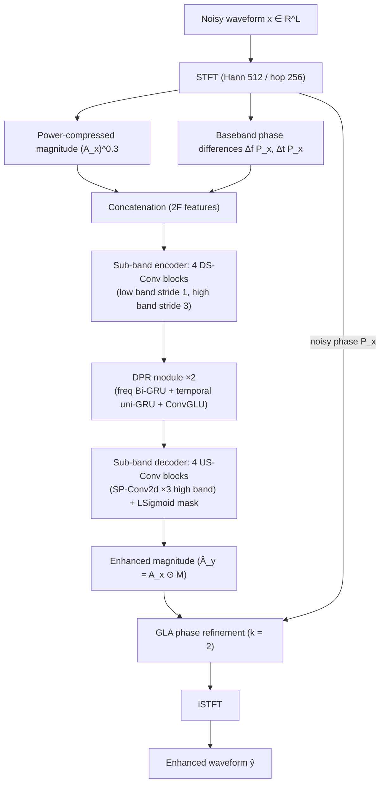

# Yan, Zhang, Fan, Zhou & Liu 2025: LiSenNet — Lightweight Sub-band and Dual-Path Modeling for Real-Time Speech Enhancement

**Authors**: [[entities/haoyin-yan|Haoyin Yan]], [[entities/jie-zhang|Jie Zhang]], [[entities/cunhang-fan|Cunhang Fan]], [[entities/yeping-zhou|Yeping Zhou]], [[entities/peiqi-liu|Peiqi Liu]]
**Affiliations**: NERC-SLIP, University of Science and Technology of China (USTC), Hefei; Anhui Province Key Laboratory of Multimodal Cognitive Computation, Anhui University, Hefei; China Merchants Bank (CMB), Shenzhen
**Venue**: IEEE ICASSP 2025
**Type**: Conference Paper
**DOI**: [10.1109/ICASSP49660.2025.10888272](https://doi.org/10.1109/ICASSP49660.2025.10888272)
**Zotero**: [Open in Zotero](zotero://select/items/0_I6PIKXDT)

## Summary

LiSenNet is a lightweight speech enhancement network achieving competitive quality with only **37k parameters and 56M MACs/s** — half the parameters of the then-SOTA lightweight FSPEN (79k) with 63% of its MACs, while improving PESQ by 0.10 (3.07 vs. 2.97 on VoiceBank+DEMAND). Its three design ingredients are (i) **sub-band downsampling/upsampling convolutions** that preserve low-frequency resolution while aggressively downsampling the perceptually less important high frequencies, (ii) a causal **dual-path recurrent (DPR)** module with a convolutional gated linear unit (ConvGLU) channel mixer, and (iii) a **noise detector** front-end that skips the SE back-end on clean frames, cutting compute to 15–70M MACs/s depending on the noise proportion. Phase is refined post-hoc with a 2-iteration Griffin–Lim algorithm rather than being explicitly estimated.

## Problem Formulation

Given the noisy waveform $\mathbf{x} \in \mathbb{R}^L$, the goal is to recover the clean speech $\hat{\mathbf{y}} \in \mathbb{R}^L$ with a model small enough for **latency-sensitive, low-resource edge devices** (hearing aids, headphones, IoT). Learning-based SE models outperform traditional signal processing in non-stationary scenes, but DNN SE models such as CRN (17.58M params, 2.56G MACs), DCCRN (3.67M, 14.38G), and FullSubNet (5.64M, 30.87G) are far too heavy for such targets. Prior lightweight designs — RNNoise (0.06M/0.04G but PESQ 2.33), the CCFNet+ (Lite) two-stage approach (160k/390M), and FSPEN (79k/89M) — leave room for a smaller model at equal or better quality.

The model estimates the **enhanced magnitude** $\hat{\mathbf{A}}_y$; the output spectrum combines it with a GLA-refined phase, and the waveform is reconstructed via iSTFT.

## Methodology

![[raw/papers/yan-2025-lisennet/figures/7d480109446234b5f2498e03a91897dc419101d70a76e7e091ebc295d6c9ac16.jpg|LiSenNet framework]]

*Figure 1: (a) The LiSenNet framework — STFT magnitude and phase-difference features feed a sub-band Conv encoder-decoder with a dual-path recurrent bottleneck; (b) an example of sub-band DS-Conv and sub-band US-Conv (low frequencies keep stride 1, high frequencies are strided 3× so the net frequency-axis rate is halved); (c) the DPR module (frequency Bi-GRU + temporal unidirectional GRU + ConvGLU channel mixer); (d) the optional noise detector on 64-dim Mel spectrogram features.*

### Model Input

The complex spectrum $\mathbf{X} \in \mathbb{C}^{T \times F}$ is obtained via STFT. The network consumes the concatenation of:

1. **Power-compressed magnitude** $(\mathbf{A}_x)^c$ with $c = 0.3$ (following Braun & Tashev's loss-function study), equalizing the importance of quiet vs. loud sounds;
2. **Phase differences (PD)**, motivated by the observation that PD exhibits similar patterns to the magnitude spectrum (Mowlaee & Saeidi):
   - frequency-axis $\Delta_f \mathbf{P}_x(t,f) = \mathbf{P}_x(t,f) - \mathbf{P}_x(t,f-1)$
   - temporal (baseband) $\Delta_t \mathbf{P}_x(t,f) = \mathbf{P}_x(t,f) - \mathbf{P}_x(t-1,f) - 2\pi f \frac{Q}{M}$, where $Q$ and $M$ are the frame shift and length. The linear term $2\pi f Q/M$ removes the phase offset induced by overlapping STFT frames so the temporal PD is baseband-aligned (following Krawczyk & Gerkmann).

Ablation: removing PD drops PESQ from 3.07 to 2.99 — PD helps the magnitude estimation even though the network never outputs a phase estimate.

### Encoder / Decoder with Sub-band Convolutions

Each Conv block is Conv2d + LayerNorm + PReLU. The encoder uses **downsampling convolutions (DS-Conv)** that halve the frequency axis; the decoder mirrors them with **upsampling convolutions (US-Conv)** plus skip connections. The distinctive choice: **low- and high-frequency bands are treated differently**.

- **Low frequencies** (more important for human hearing, following Hermansky's PLP argument): Conv2d with stride 1 — full resolution is preserved.
- **High frequencies**: Conv2d with stride 3 in the downsampling, [[concepts/sub-pixel-convolution|sub-pixel convolution]] (SP-Conv2d) with factor 3 in the upsampling.

Because the whole frequency axis is also halved by the DS-Conv blocks, the **net frequency-axis downsampling factor is 2** while low-frequency resolution is maintained.

### Mask Activation: Learnable Sigmoid

The decoder's last layer predicts the mask via the learnable Sigmoid from [[concepts/pesq|MetricGAN+]]:

$$\mathrm{LSigmoid}(x) = \beta / \left(1 + e^{-\alpha x}\right)$$

with constant $\beta = 2.0$ and a **trainable, frequency-dependent** $\alpha \in \mathbb{R}^{F}$. Because speech has distinct low- vs. high-frequency patterns, the per-band $\alpha$ lets the mask's shape adapt per frequency band. Freezing the learnable parameters ("w/o LSigmoid") drops PESQ 3.07 → 3.05.

### Dual-Path Recurrent (DPR) Module

The bottleneck follows the dual-path paradigm of [[concepts/dprnn|DPRNN]]: the feature map $\mathbf{M} \in \mathbb{R}^{B \times C \times T \times F}$ is reshaped to $BT \times F \times C$ for **frequency modeling** and $BF \times T \times C$ for **temporal modeling**. Causality is preserved by using:

- **Bi-GRU** for frequency modeling (all bins of a frame are available at once — bidirectionality along frequency is causal in time), and
- **unidirectional GRU** for temporal modeling.

The RNN nodes are deliberately shrunk for real-time budgets (hidden size 24 / 12), and the resulting capacity loss is compensated by a **ConvGLU** channel mixer (modified from TransNeXt): a linear layer + depthwise convolution + Mish activation. The depthwise convolution aggregates neighboring-channel information; the gate provides fine-grained channel attention. Removing ConvGLU drops PESQ 3.07 → 2.98.

### Phase Refinement via Griffin–Lim

Rather than reusing the noisy phase or learning a phase estimate, LiSenNet refines phase post-hoc with the **Griffin–Lim algorithm (GLA)** as a parameter-free post-processor:

$$\hat{\mathbf{P}}_y = \mathrm{GLA}(\hat{\mathbf{A}}_y, \mathbf{P}_x)$$

i.e., starting from the noisy phase, iteratively applying $P^{(k)} = \angle\,\mathrm{STFT}(\mathrm{iSTFT}(\mathbf{A} e^{j\mathbf{P}^{(k-1)}}))$. The argument: GLA was long considered inaccurate for SE because the enhanced magnitude itself carried errors, but *modern SE models produce sufficiently accurate magnitudes*, making GLA phase refinement worth revisiting. Ablation: GLA raises PESQ from 3.02 (noisy phase) to 3.07 with **k = 2 iterations sufficient for convergence** (k=1: 3.06; k=3: 3.07).

### Noise Detector (ND) — Optional Front-End

For instantaneous/short-duration noise, running the SE module continuously wastes resources. The noise detector is a small network on **64-dimensional Mel spectrogram** features that outputs **frame-level binary noisy/clean decisions** (Sigmoid, 0 = clean, 1 = noisy); only noisy frames are sent to the SE back-end. LiSenNet+ND: 55k params, 15–70M MACs/s depending on the noise proportion — in the extreme all-clean case only 15M MACs/s.

### Model Structure, Inputs, and Outputs

**LiSenNet (main SE network)**

| Spec | Value |
|------|-------|
| **Structure** | 4 DS-Conv encoder blocks (Conv2d + LayerNorm + PReLU; channels {4, 8, 12, 16}) → DPR × 2 → 4 US-Conv decoder blocks (channels {12, 8, 4, 1}) + LSigmoid |
| **DPR internals** | Frequency path: Bi-GRU (hidden 12); temporal path: unidirectional GRU (hidden 24); ConvGLU = linear + depthwise conv + Mish |
| **Input** | Power-compressed magnitude ($c = 0.3$) concatenated with frequency and baseband temporal phase differences, at 16 ms hop (62.5 frames/s), 32 ms Hann window |
| **Output** | T-F mask (LSigmoid) → enhanced magnitude, one frame per 16 ms |
| **Training data** | VoiceBank+DEMAND (28 speakers / 11,572 training utterances, 16 kHz); noise detector on WSJ0+ESC50 |
| **Role** | Magnitude-mask SE back-end |
| **Size / cost** | 37k params, 56M MACs/s |

**Noise detector (optional front-end)**

| Spec | Value |
|------|-------|
| **Structure** | Conv blocks with channels {4, 8, 16, 32} on 64-dim Mel spectrogram; Sigmoid output |
| **Input** | 64-dimensional Mel spectrogram of the noisy signal |
| **Output** | Per-frame binary noise decision (0 = clean, 1 = noisy) at 16 ms frame rate |
| **Training data** | WSJ0+ESC50 (14.2 h train / 0.7 h test; 4-s clips containing 0.5–2 s of noise, SNR −10 to 5 dB) |
| **Role** | Gate: only noisy frames are sent to the SE back-end |
| **Size / cost** | +18k params on top of LiSenNet; 15–70M MACs/s total depending on noise proportion |

### Training Losses

$$\mathcal{L} = \lambda_1 \mathcal{L}_{\mathrm{mag}} + \lambda_2 \mathcal{L}_{\mathrm{comp}} + \lambda_3 \mathcal{L}_{\mathrm{pesq}} + \mathcal{L}_{\mathrm{bce}}$$

with empirical weights $\lambda_1 = 0.9$, $\lambda_2 = 0.1$, $\lambda_3 = 0.05$:

- $\mathcal{L}_{\mathrm{mag}} = \mathbb{E}[\| \mathbf{A}_y^c - \hat{\mathbf{A}}_y^c \|^2]$ — MSE on power-compressed magnitudes;
- $\mathcal{L}_{\mathrm{comp}} = \mathbb{E}[\| \mathbf{Y}^c - \hat{\mathbf{Y}}^c \|^2]$ — MSE on power-compressed complex spectra ($\mathbf{Y}^c = \mathbf{A}_y^c e^{j\mathbf{P}_y}$), following CMGAN's loss;
- $\mathcal{L}_{\mathrm{pesq}} = \mathbb{E}[\| D(\mathbf{A}_y^c, \hat{\mathbf{A}}_y^c) - 1 \|^2]$ — **PESQ loss** via a discriminator $D$ trained to predict PESQ scaled to (0, 1), in the MetricGAN+ tradition: the term pushes the generated magnitude toward a maximal PESQ score. Ablation: removing it drops PESQ 3.07 → 2.95;
- $\mathcal{L}_{\mathrm{bce}}$ — binary cross-entropy for the noise detector (only when the ND is included).

Trained with AdamW, 100 epochs, learning rate 5e-4 decayed ×0.98 per epoch, gradient clipping (L2 norm) 5.0.

## Experimental Setup

| Parameter | Setting |
|-----------|---------|
| **SE dataset** | VoiceBank+DEMAND: 11,572 train utterances (28 speakers), 872 test (2 speakers); train SNRs {0, 5, 10, 15} dB, test {2.5, 7.5, 12.5, 17.5} dB; 16 kHz |
| **ND dataset** | WSJ0+ESC50 (new): 4-s WSJ0 clips + ESC50 noises, 0.5–2 s noise per clip, SNR −10 to 5 dB uniform; 14.2 h train / 0.7 h test |
| **STFT** | Hann window 512 (32 ms), hop 256 (16 ms) |
| **Encoder/decoder/ND channels** | {4, 8, 12, 16} / {12, 8, 4, 1} / {4, 8, 16, 32} |
| **GRU hidden states** | 24 (temporal, unidirectional), 12 (frequency, bidirectional) |
| **DPR repetitions** | N = 2 |
| **GLA iterations** | k = 2 |
| **Optimizer** | AdamW, 100 epochs, lr 5e-4 × 0.98/epoch decay, L2 grad clip 5.0 |
| **Metrics** | Parameters, MACs, PESQ, STOI, RTF (Intel Xeon E5-2620 v4 CPU) |
| **Baselines** | RNNoise, CRN, DCCRN, FullSubNet, Fast FullSubNet, CCFNet+ (Lite), FSPEN (retrained where starred) |

## Results

### VoiceBank+DEMAND (Table I)

| Method | Para. | MACs | PESQ | STOI |
|--------|-------|------|------|------|
| Noisy | — | — | 1.97 | 0.921 |
| RNNoise | 0.06M | 0.04G | 2.33 | 0.922 |
| CRN* | 17.58M | 2.56G | 2.54 | 0.936 |
| DCCRN* | 3.67M | 14.38G | 2.78 | 0.940 |
| FullSubNet* | 5.64M | 30.87G | 2.89 | 0.940 |
| Fast FullSubNet* | 6.84M | 4.14G | 2.79 | 0.935 |
| CCFNet+ (Lite) | 160k | 390M | 2.94 | — |
| FSPEN | 79k | 89M | 2.97 | 0.942 |
| **LiSenNet** | **37k** | **56M** | **3.07** | 0.939 |

LiSenNet beats FSPEN's PESQ by 0.10 with 47% of its parameters and 63% of its MACs; it is competitive with FullSubNet-class quality at ~150× fewer parameters.

### WSJ0+ESC50 with Noise Detector (Table II)

| Method | Para. | MACs | RTF | PESQ |
|--------|-------|------|-----|------|
| Noisy | — | — | — | 1.86 |
| CRN | 17.58M | 2.56G | 0.042 | 2.80 |
| DCCRN | 3.67M | 14.38G | 0.184 | 3.05 |
| FullSubNet | 5.64M | 30.87G | 0.386 | 2.99 |
| Fast FullSubNet | 6.84M | 4.14G | 0.100 | 2.75 |
| **LiSenNet** | 37k | 56M | 0.028 | **3.08** |
| LiSenNet+ND | 55k | 15M~70M | **0.020** | 3.00 |

LiSenNet attains the best PESQ (3.08) and RTF (0.028) on this dataset; adding the noise detector lowers RTF further to 0.020 and bounds MACs at 15M (all-clean) to 70M — still far below every baseline — at the cost of 0.08 PESQ from imperfect detection and information loss in clean regions.

![[raw/papers/yan-2025-lisennet/figures/7d60ae2da2739ccf605a15249bdc981010d181a64026fcc3addf6cbc978c3714.jpg|RTF under different noise proportions]]

*Figure 2: RTF under different noise-proportion conditions — the noise detector's savings are largest when the noise proportion in speech is low.*

### Ablation (Table III, VoiceBank+DEMAND)

| Variant | Para. | MACs | PESQ | STOI |
|---------|-------|------|------|------|
| LiSenNet | 37k | 56M | 3.07 | 0.939 |
| w/o PD | 37k | 56M | 2.99 | 0.936 |
| w/o $\mathcal{L}_{\mathrm{pesq}}$ | 37k | 56M | 2.95 | 0.937 |
| w/o sub-band Conv | 30k | 54M | 3.01 | 0.938 |
| w/o ConvGLU | 31k | 48M | 2.98 | 0.937 |
| w/o LSigmoid | 37k | 56M | 3.05 | 0.938 |
| DPR (N=0) | 15k | 22M | 2.68 | 0.913 |
| DPR (N=1) | 26k | 39M | 2.97 | 0.935 |
| DPR (N=2) | 37k | 56M | 3.07 | 0.939 |
| DPR (N=3) | 48k | 72M | 3.06 | 0.940 |
| GLA (noisy phase) | 37k | 56M | 3.02 | 0.939 |
| GLA (k=1) | 37k | 56M | 3.06 | 0.939 |
| GLA (k=2) | 37k | 56M | 3.07 | 0.939 |
| GLA (k=3) | 37k | 56M | 3.07 | 0.939 |

Key findings: (i) the PESQ loss is the largest single contributor (+0.12 PESQ); (ii) sub-band convolution, ConvGLU, and LSigmoid each contribute modest but real gains; (iii) **N = 2 DPR repetitions is the sweet spot** (N=1: 2.97; N=3: 3.06 with more compute); (iv) GLA converges at k = 2; (v) PD input features add +0.08 PESQ at zero parameter cost.

## Key Contributions

1. **Sub-band DS-Conv / US-Conv blocks**: an asymmetric frequency-axis compression scheme that preserves low-frequency resolution (stride 1) while aggressively downsampling high frequencies (stride 3 + SP-Conv2d ×3 upsampling), for a net ×2 frequency reduction — encoding the perceptual prior that low bands matter more for hearing.
2. **Causal dual-path recurrent module with ConvGLU**: frequency Bi-GRU + temporal unidirectional GRU bottleneck with a linear+depthwise-conv+Mish channel mixer, compensating for the shrunken RNN state sizes needed for real-time budgets.
3. **Noise detector front-end**: an optional Mel-spectrogram frame-level noise gate that makes compute **proportional to the noise content** (15–70M MACs/s) rather than constant — most valuable for instantaneous-noise scenarios.
4. **Efficiency frontier result**: 37k params / 56M MACs/s at PESQ 3.07 on VoiceBank+DEMAND, beating FSPEN's PESQ by 0.10 with 47% of its parameters — establishing the lightweight-SE operating point that later works (CoFi-Lite, AdaptCRN, HALO, μNet) use as a standard baseline.
5. **GLA phase refinement revisited**: a parameter-free 2-iteration Griffin–Lim post-processor on the enhanced magnitude + noisy phase (+0.05 PESQ over noisy phase), predicated on the observation that modern magnitude estimates are accurate enough for GLA to help.

## Related Concepts

- [[concepts/lisennet|LiSenNet]]
- [[concepts/noise-detector|Noise Detector (adaptive SE gating)]]
- [[concepts/dprnn|Dual-Path RNN (DPRNN)]]
- [[concepts/convolutional-recurrent-network|Convolutional Recurrent Network (CRN)]]
- [[concepts/sub-band-convolution|Sub-band Convolution]]
- [[concepts/convglu|ConvGLU]]
- [[concepts/learnable-sigmoid-mask|Learnable Sigmoid Mask]]
- [[concepts/phase-difference-feature|Phase Difference (PD) Feature]]
- [[concepts/gla-phase-refinement|GLA Phase Refinement]]
- [[concepts/sub-pixel-convolution|Sub-Pixel Convolution]]
- [[concepts/power-law-compression|Power-Law Compression]]
- [[concepts/gated-recurrent-unit|Gated Recurrent Unit (GRU)]]
- [[concepts/voice-activity-detection|Voice Activity Detection]]
- [[concepts/voicebank-demand|VoiceBank+DEMAND]]
- [[concepts/pesq|PESQ]]
- [[concepts/gtcrn|GTCRN]]

## Related Synthesis

- [[synthesis/computational-efficiency-evolution|Computational Efficiency Evolution]]
- [[synthesis/deep-speech-enhancement|Deep Speech Enhancement]]
- [[synthesis/joint-multitask-ultra-low-latency-se|Joint Multi-Task SE & Ultra-Low-Latency Paradigm]]
