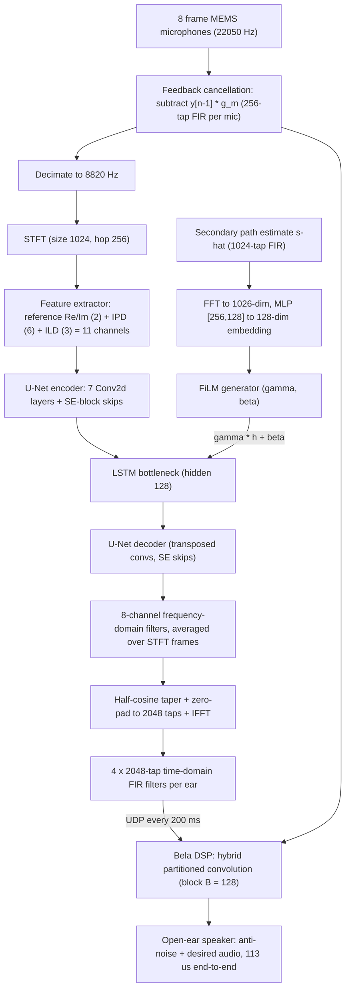

# Yuan, Liu & Xiao 2026: Active Noise Cancellation on Open-Ear Smart Glasses

**Authors**: Kuang Yuan*, Freddy Yifei Liu*, Tong Xiao*, Yiwen Song, Chengyi Shen, Saksham Bhutani, Justin Chan†, Swarun Kumar† (* equal contribution, † corresponding)
**Institutions**: Carl von Ossietzky Universität Oldenburg (Yuan, Liu, Xiao); Carnegie Mellon University (Song, Bhutani, Chan, Kumar); Zhejiang University (Shen)
**Venue**: arXiv preprint 2604.05519, 2026
**Version**: submitted 2026-04-07, v2 2026-09-10 (Nature-style manuscript)
**DOI**: [10.48550/arXiv.2604.05519](https://doi.org/10.48550/arXiv.2604.05519)
**📎 Zotero**: [zotero://select/items/0_TVS87FW6](zotero://select/items/0_TVS87FW6)

## Summary

Presents the first working ANC system for **open-ear wearables** (smart glasses, VR headsets, headbands) that requires **no error microphone at the ear canal**: a neural network performs **virtual in-ear sensing**, estimating 2048-tap FIR ANC filters per microphone-to-ear pair from eight MEMS microphones embedded in the glasses frame. A dual-pipeline architecture runs the network on a Raspberry Pi 5 (filter updates every 200 ms) while a Bela DSP generates anti-noise with 113 µs end-to-end latency via hybrid partitioned convolution. Across 11 unseen users and 8 unseen environments the system achieves **9.6 dB** mean noise reduction (100–1000 Hz) without calibration and **11.2 dB** with a one-time user-specific secondary-path calibration — within 4.3 dB of an oracle Wiener filter that uses a physical in-ear microphone.

![[raw/papers/yuan-2026-open-ear-anc-smart-glasses/figures/fig1.png|System overview: glasses prototype with 8 frame microphones, open-ear speakers, and dual CPU/DSP pipeline]]
*Figure 1: Open-ear ANC demonstrated on smart glasses. (a) Anti-noise played through open-ear speakers reduces noise at the unoccluded ear. (b) Interior view of the 3D-printed prototype showing microphones and speaker. (c) System architecture: eight frame microphones feed a neural network on the embedded CPU that performs virtual in-ear sensing to estimate per-ear ANC filters; a DSP applies them in real time.*

## Problem Formulation

Conventional [[concepts/active-noise-control|ANC]] relies on a **closed acoustic coupling**: an error microphone at the ear canal measures residual noise and provides the feedback signal required by gradient-based adaptive controllers (e.g., [[concepts/filtered-x-lms-algorithm|filtered-x LMS]]). Open-ear devices leave the ear unoccluded, so no error microphone can be placed there and the residual $e[n]$ cannot be measured — the fundamental reason effective ANC has been confined to headphones and earbuds.

For one ear side, the system is modeled as a multiple-input single-output (MISO) feedforward ANC problem with $M = 4$ frame reference microphones. The primary noise at the ear, the speaker drive, and the residual are

$$D(z)=\sum_{m=1}^{M}P_{m}(z)X_{m}(z),\qquad Y(z)=\sum_{m=1}^{M}W_{m}(z)X_{m}(z),\qquad E(z)=D(z)+S(z)Y(z),$$

where $P_m(z)$ are primary paths, $W_m(z)$ the ANC control filters, and $S(z)$ the secondary path (DAC → amplifier → speaker → acoustic propagation to the ear). The optimal filter per channel satisfying $E(z)=0$ is $W_{m,\mathrm{opt}}(z) = -P_m(z)/S(z)$, equivalently the regularized Wiener solution

$$\mathbf{w}_{\mathrm{opt}}=-(\bm{\Upphi}_{\mathbf{rr}}+\beta\mathbf{I})^{-1}\bm{\upphi}_{\mathbf{r}d},$$

with filtered-reference autocorrelation $\bm{\Upphi}_{\mathbf{rr}}=\mathcal{E}\{\mathbf{r}[n]\mathbf{r}^{\mathrm{T}}[n]\}$, cross-correlation $\bm{\upphi}_{\mathbf{r}d}=\mathcal{E}\{\mathbf{r}[n]d[n]\}$, and $\beta = \beta_0\,\mathrm{tr}(\bm{\Upphi}_{\mathbf{rr}})/(M L_C)$, $\beta_0 = 10^{-4}$ (filter-energy regularization also prevents speaker overload). Solving this requires the physical error signal $d[n]$ — precisely what open-ear devices lack. The paper's key move: replace the closed-form/adaptive solution with a **network that directly estimates $\mathbf{w}$ from frame microphones only**, treating the primary paths as [[concepts/relative-transfer-function|relative transfer functions]] learnable from the rigid-frame geometry.

## Methodology

![[raw/papers/yuan-2026-open-ear-anc-smart-glasses/figures/fig2.png|System architecture: dual pipeline, neural network, and hybrid partitioned convolution]]
*Figure 2: System architecture. (a) Dual-pipeline design: CPU neural network estimates ANC filters; DSP generates anti-noise. (b) Network: STFT → IPD/ILD/reference features → U-Net with SE blocks and LSTM bottleneck, conditioned on the secondary path via FiLM. (c) Hybrid partitioned convolution on the DSP: direct time-domain segment + frequency-domain partitioned segments.*

The system separates two timescales onto two processors: (i) **estimating** how sound propagates to the ear (varies over hundreds of ms) runs on the CPU as a neural network; (ii) **applying** the filters sample-by-sample (sub-millisecond budget) runs on a dedicated DSP. Noise diffracts around the head, producing correlated measurements at frame microphones and the ear; because the rigid frame fixes the geometry, these correlations — encoded as [[concepts/virtual-in-ear-sensing|virtual in-ear sensing]] — can be learned from spatial cues and generalize to unseen users and environments.

### Model Structure, Inputs, and Outputs

**Filter-estimation network** (per ear side):

| Spec | Value |
|------|-------|
| Structure | U-Net encoder–decoder with skip connections. Encoder: 7 Conv2d layers, channel progression [32, 64, 64, 128, 128, 256, 256], kernel (5, 2), stride (2, 1), batch norm + PReLU. Squeeze-and-excitation blocks (reduction ratio 4) on every skip. Bottleneck: single-layer unidirectional LSTM, hidden 128. Decoder: mirrored transposed convolutions. Final conv projects to $2M = 8$ channels (real + imaginary parts of the frequency-domain filter per microphone). |
| Input | $L_N = 2$ s of the 4 per-side microphone signals, decimated from 22050 Hz to 8820 Hz; STFT (1024/256, 513 bins); features per TF frame: reference-spectrogram Re/Im (2 ch) + interchannel phase difference sin/cos for 3 non-reference mics (6 ch) + interchannel level difference (3 ch) = **11 channels** |
| Output | Per STFT frame: 8-channel frequency-domain filter; per-frame estimates averaged over time, tapered (half-cosine, top 12.5% bins), zero-padded to $L_C = 2048$ taps at 22050 Hz, IFFT + 10% tail fade-out → **4 time-domain FIR filters (2048 taps) per ear**, applied to the next 200 ms of audio |
| Training data | Stage 1: 24 h mannequin-head recordings (5 rooms, 2 positions, 36 azimuths, up to 3 noise sources, in-ear ground truth). Stage 2: fine-tune on human recordings (16 participants, 12 environments, 3 cross-validated groups) |
| Role | Estimates the ANC control filters that map frame microphones to the anti-noise waveform — replacing the in-ear error microphone |

**Secondary-path encoder (FiLM conditioning)**:

| Spec | Value |
|------|-------|
| Structure | Real-FFT of the 1024-tap secondary-path impulse response → concatenated Re/Im of 513 bins (1026-dim) → MLP with hidden dims [256, 128] → 128-dim embedding → FiLM generator producing $(\gamma, \beta)$ |
| Input | Estimated secondary path $\hat{s}[n]$: user-specific (ESS calibration) or population-averaged fallback |
| Output | Affine parameters modulating the LSTM bottleneck as $\gamma \odot \mathbf{h} + \beta$ — user adaptation **without retraining** (~512 bytes per user vs ~16 MB for full fine-tuning) |
| Role | Conditions filter estimation on each user's speaker-to-ear acoustics |

Network size: **4.2M parameters, 5.3G MACs per inference** (Small variant 1.1M / 1.4G; Large 9.4M / 11.8G). Deployment: PyTorch → ONNX opset 17, ONNX Runtime with ARM NEON on Raspberry Pi 5; STFT reimplemented as Conv1d filter banks, complex arithmetic split into real/imag paths, secondary-path FFT fused into the first MLP matrix, IFFT replaced by a precomputed inverse-DFT matrix.

### Training Losses

Single loss — $L_1$ on the ear residual, computed through the estimated secondary path:

$$\mathcal{L}=\|e[n]\|_{1}=\|d[n]+\hat{d}[n]\|_{1},\qquad \hat{d}[n]=\hat{s}[n]*\sum_{m=1}^{M}(w_{m}[n]*x_{m}[n]),$$

where $d[n]$ is the ground-truth in-ear microphone signal recorded during training. The network learns *which filters minimize the residual* rather than reconstructing the ear signal. Although the deployment metric is residual **energy** (suggesting $L_2$), $L_1$ works better: 10.4 dB vs 9.7 dB for otherwise identical models. The $L_2$ gradient is dominated by the largest residual components — energy below the secondary path's low-frequency roll-off and incoherent high-frequency content, which no causal filter can cancel — while $L_1$ weights errors uniformly and directs capacity to the cancelable band.

### Secondary-Path Estimation and Calibration

The secondary path is modeled as a 1024-tap FIR measured with an exponential sine sweep (20 Hz–11025 Hz, 20 s, played twice and averaged, deconvolved with first-order magnitude shaping). [[concepts/secondary-path-modeling|Secondary-path modeling]] feeds both the training loss and the FiLM conditioning; without a user calibration, a population-averaged path is used. The method is robust to noisy calibration (degrades <1.7 dB even at −20 dB calibration SNR) and 32 taps suffice (within 0.1 dB of 1024 taps), confirming 1024 taps is conservative. This addresses [[concepts/secondary-path-variability|secondary-path variability]] (inter-user std of noise reduction: 1.5 dB → 0.4 dB with calibration).

### Real-Time Anti-Noise: Hybrid Partitioned Convolution

At 22050 Hz the DSP (Bela on BeagleBone Black) must process each sample within $1/f_s = 45\,\mu$s. The 2048-tap filter is split via [[concepts/hybrid-partitioned-convolution|hybrid partitioned convolution]]: the first $2B$ taps ($B = 128$) run as direct time-domain convolution on the real-time audio thread; the remaining 14 blocks of $B$ taps run as frequency-domain partitioned convolution (2B-point FFTs, overlap-add) on a background thread, crossfaded over one block at filter updates. Median per-sample processing: **38 µs**; end-to-end loopback latency (mic in → speaker out): **113 µs** (45 µs computation + 68 µs ADC/DAC/analog chain). Direct time-domain convolution would only meet the budget up to 1024 taps.

### Acoustic Feedback Cancellation

Anti-noise leaking into the frame microphones is removed by a standard AFC stage: 256-tap speaker-to-microphone feedback paths $\hat{g}_m[n]$ (ESS-estimated) subtract the predicted leakage from the raw signals,

$$x_{m}[n]=x^{\prime}_{m}[n]-(y[n-1]*\hat{g}_{m}[n]),$$

so both the network input and the real-time convolution see only external noise, preventing instability. Crosstalk to the contralateral ear is negligible (33.1 dB broadband / 32.3 dB in-band ipsilateral dominance), so the two ears run as independent MISO systems.

## Experimental Setup

| Item | Value |
|------|-------|
| Hardware | Custom 3D-printed glasses: 8× SPH8878LR5H-1 MEMS microphones, speakers from Meta Oakley Vanguard glasses + MAX98306 amplifier; Raspberry Pi 5 (NN inference) + Bela (BeagleBone Black, 200 MHz PRU DSP), UDP over Ethernet; 5–7 W total, ~4 h on 5 V/5000 mAh |
| Sampling | 22050 Hz (lowest 8-ch rate supported); 1-sample blocks → 45 µs compute budget; NN filter updates every 200 ms (median update latency 136 ms, p95 145 ms, max 161 ms) |
| Noises | 11 real-world types (car, bus, washer, HVAC, fan, airplane cabin, mall, café, city, vacuum, rain; from TAU Urban, Vehicle Interior, myNoise, MIMII, MS-SNSD) + colored noises; target band 100–1000 Hz, 4th-order Butterworth |
| Mannequin data | 24 h across 5 rooms (3 train / 2 test), 36 azimuths, up to 3 concurrent sources, in-ear ground truth; +8 h held out for colored-noise/speaker/anechoic evaluations |
| Human data | 16 participants (3 groups, cross-group validation), 12 environments; evaluation on 11 unseen users × 8 unseen environments (7 indoor + 1 outdoor, RT60 0.48–0.90 s) |
| Training | Two-stage: pre-train on mannequin data (AdamW, lr 4×10⁻⁴, batch 32, 100 epochs = 50 constant + 50 cosine decay to 10⁻⁶), fine-tune on human data (lr 10⁻⁴, 50 epochs); $L_1$ loss, 2 s context |
| Augmentation | Speed perturbation [0.75, 1.25]; multi-source mixing (up to 3 sources, SNR ∈ [−5, 5] dB, p = 0.7); secondary-path augmentation (gain ±5 dB, pairwise interpolation, ±1 sample shift) — jointly 9.7 → 11.2 dB |
| Metric | Noise reduction $=10\log_{10}\left(\sum\tilde{d}^2/\sum\tilde{e}^2\right)$ in the 100–1000 Hz band |

## Results

![[raw/papers/yuan-2026-open-ear-anc-smart-glasses/figures/fig4.png|Mannequin-head evaluation: DOA dependence, noise types, microphone count ablation]]
*Figure 4: Benchtop evaluation on a mannequin head. (c) Noise reduction across DOAs (>6 dB at all angles; worst case on the ipsilateral side where acoustic lookahead is shortest). (d) Reduction across noise types — low-frequency-dominated noises cancel best. (g) Microphone-count ablation: 5.3 dB (1 mic) → 10.4 dB (4 mics), plateau at 6.*

### Mannequin head (benchtop)

| Aspect | Result |
|--------|--------|
| Mean across 11 real noises | **10.1 ± 2.7 dB** (car 15.3, bus 13.6, airplane cabin 10.1, café 8.9, vacuum 7.0, rain 6.0) |
| Colored noises | brown 13.8 dB, pink 8.5 dB, white 4.6 dB (worst case: flat spectrum, no temporal correlation) |
| DOA dependence | >6 dB at all azimuths; left ear worst near 270°, right ear worst near 90° (shortest lookahead) |
| Microphone count (per side) | 1 → 5.3, 2 → 8.9, 3 → 10.0, 4 → 10.4, 6 → 10.4 dB (operating point: 4) |
| Oracle Wiener filter | 14.7 dB (computed from physical in-ear mic) → network within **4.3 dB** of oracle |
| Anechoic vs reverberant | 9.1 dB (anechoic) vs 10.1 dB (reverberant) — reflections add lookahead; anechoic is a conservative lower bound |
| Multiple sources | >9.0 dB with 1–3 simultaneous sources; never amplifies noise (safety property without error mic) |
| Filter length | 512 → 10.0, 1024 → 10.5, 2048 → 11.1, 4096 → 11.8 dB (2048 chosen for latency headroom) |
| DSP latency sweep | 11.1 dB at 45 µs degrading to 4.4 dB at 726 µs — latency is critical for cancellation |

### Real-world users (11 unseen users × 8 unseen environments)

![[raw/papers/yuan-2026-open-ear-anc-smart-glasses/figures/fig5.png|Real-world evaluation across users: noise reduction, calibration effect, speech/music metrics, subjective ratings]]
*Figure 5: Real-world evaluation. (a) Reduction across frequency with/without user calibration. (b) Per-participant results — calibration cuts inter-user std from 1.5 to 0.4 dB. (d) Objective speech/music metrics. (e, f) Subjective clarity and intrusiveness ratings vs ANC-off and AirPods 4.*

| Aspect | Result |
|--------|--------|
| No calibration | **9.6 dB** mean (100–1000 Hz) |
| User-specific calibration | **11.2 dB** mean; +1.6 dB over no calibration; inter-user std 1.5 → 0.4 dB |
| Environments | ≥11.0 dB in all 7 indoor rooms (mean 11.3); 9.5 dB outdoor (wind — uncorrelated, physically impossible to cancel) |
| Glasses displacement | 11.3 dB at rest vs 11.2 (looking down), 11.1 (head shaking), 10.7 (removing/re-wearing), 11.3 (exercise bike) — robust without recalibration |

### Speech and music playback enhancement

| Metric | ANC off | ANC on | Noise-free ref |
|--------|---------|---------|----------------|
| STOI | 0.59 | **0.68** | 0.88 |
| WER (Whisper Small) | 18.1% | **11.0%** | 4.0% |
| WER (Whisper Medium) | 12.0% | **8.4%** | 3.6% |
| SI-SNR speech | −6.2 dB | **+0.2 dB** | — |
| SI-SNR music | −4.7 dB | **+1.0 dB** | — |
| Clarity MOS (speech / music) | 2.1 / 2.5 | **3.7 / 4.1** | AirPods 4: 4.4 / 4.5 |
| Intrusiveness MOS (speech / music) | 1.5 / 1.8 | **3.3 / 3.6** | AirPods 4: 3.7 / 4.1 |

### Ablations

| Ablation | Result |
|---------|--------|
| No reference channel | 9.1 dB (most critical input; 9.0 with LSTM also removed) |
| No LSTM / no SE blocks | 10.3 dB each |
| Small (1.1M) / Large (9.4M) model | 9.7 / 10.6 dB |
| $L_1$ vs $L_2$ loss | 10.4 vs 9.7 dB |
| Mannequin-only / human-only / two-stage training | 10.4 / 10.1 / **11.2 dB** (calibrated); 7.6 / 9.1 / **9.6 dB** (uncalibrated) |
| No augmentation vs full augmentation | 9.7 vs 11.2 dB |

### Generalization across form factors

| Form factor | Mean reduction |
|-------------|-----------------|
| Smart glasses (physical, real data) | 11.2 dB (calibrated) |
| Smart helmet (physical) | 11.3 dB |
| VR headset (physical) | 10.9 dB |
| Smart headband (physical) | 10.8 dB |
| All geometries (simulation, 11,000 rooms) | >8.8 dB |

Commercial-relevance: Ray-Ban Meta has 5 microphones and Meta Aria Gen 2 has 7 — within the plateau of the microphone ablation, suggesting deployability on existing hardware.

![[raw/papers/yuan-2026-open-ear-anc-smart-glasses/figures/fig6.png|Environment evaluation, latency CDFs, and convolution timing comparison]]
*Figure 6: (a) Eight evaluation environments with per-environment reduction. (b) CDF of neural filter-update latency (median 136 ms → 200 ms update period). (c) Time-domain vs hybrid partitioned convolution: hybrid meets the 45 µs budget up to 2048 taps. (d) Reduction vs filter length.*

## Key Contributions

1. **First practical ANC on open-ear wearables without an error microphone**: feedback-free ANC on smart glasses validated on 11 unseen users in 8 unseen real environments under mobility — previously open-ear devices had no working ANC architecture.
2. **Virtual in-ear sensing**: a U-Net + LSTM + FiLM network that estimates per-microphone 2048-tap ANC filters from IPD/ILD/reference features of frame microphones, exploiting the rigid-frame geometry; generalizes to unseen users and environments without prior acoustic measurement.
3. **Dual-pipeline real-time architecture**: CPU neural inference (200 ms filter updates) cleanly separated from a Bela DSP running hybrid partitioned convolution at 113 µs end-to-end latency — a compute split that mirrors commercial smart-glasses SoCs (application processor + DSP subsystem).
4. **Extensive real-world validation**: 9.6/11.2 dB (no/user calibration), within 4.3 dB of an oracle Wiener filter using a physical in-ear microphone; never amplifies noise in any tested condition; robust to glasses displacement and mid-recording noise changes.
5. **Generalizes across open-ear form factors**: helmet (11.3 dB), VR headset (10.9 dB), headband (10.8 dB), and extension results in simulation across diverse microphone geometries.

## Limitations and Caveats

- **Wind**: outdoor performance drops to 9.5 dB; turbulent airflow is uncorrelated noise that no anti-noise can cancel (commercial devices gate feedforward gain on wind detection — same cues available here).
- **200 ms filter update rate**: fast scene changes (head movements, rapidly moving sources) are limited by inference/communication latency; incremental processing, NPU offload (e.g., Snapdragon AR1's Hexagon), and SoC integration could shorten it.
- **Prototype hardware**: two boards at 5–7 W (~4 h battery); practical deployment needs an integrated SoC.
- **Calibration** still needs a temporary in-ear microphone once per user; long-term wear (hair, hats, sensitivity drift) may degrade the stored secondary path.
- **User study not fully blinded** vs AirPods 4 (physically distinguishable devices) — AirPods numbers are a qualitative reference only.
- **High frequencies pass unattenuated** (no passive isolation) — framed as preserving speech cues, alarms, and sirens, but low-frequency-focused operation (100–1000 Hz) leaves residual masking of higher-frequency speech content.

## Related Concepts

- [[concepts/virtual-in-ear-sensing|Virtual In-ear Sensing]]
- [[concepts/hybrid-partitioned-convolution|Hybrid Partitioned Convolution]]
- [[concepts/active-noise-control|Active Noise Control]]
- [[concepts/multi-channel-anc|Multi-Channel ANC]]
- [[concepts/virtual-sensing|Virtual Sensing]]
- [[concepts/remote-microphone-technique|Remote Microphone Technique]]
- [[concepts/secondary-path-modeling|Secondary Path Modeling]]
- [[concepts/secondary-path-variability|Secondary Path Variability]]
- [[concepts/film-layer|FiLM Layer]]
- [[concepts/wiener-filter|Wiener Filter]]
- [[concepts/relative-transfer-function|Relative Transfer Function]]
- [[concepts/filtered-x-lms-algorithm|Filtered-x LMS Algorithm]]
- [[concepts/open-ear-headphones|Open-Ear Headphones]]
- [[concepts/hearables|Hearables]]
- [[concepts/spatially-selective-anc|Spatially Selective ANC]]
- [[concepts/semantic-hearing|Semantic Hearing]]

## Related Synthesis

- [[synthesis/application-specific-anc|Application-Specific ANC]]
- [[synthesis/modern-headphone-anc-systems|Modern Headphone ANC Systems]]

## Related Entities

- [[entities/kuang-yuan|Kuang Yuan]]
- [[entities/freddy-yifei-liu|Freddy Yifei Liu]]
- [[entities/tong-xiao|Tong Xiao]]
- [[entities/yiwen-song|Yiwen Song]]
- [[entities/chengyi-shen|Chengyi Shen]]
- [[entities/saksham-bhutani|Saksham Bhutani]]
- [[entities/justin-chan|Justin Chan]]
- [[entities/swarun-kumar|Swarun Kumar]]
