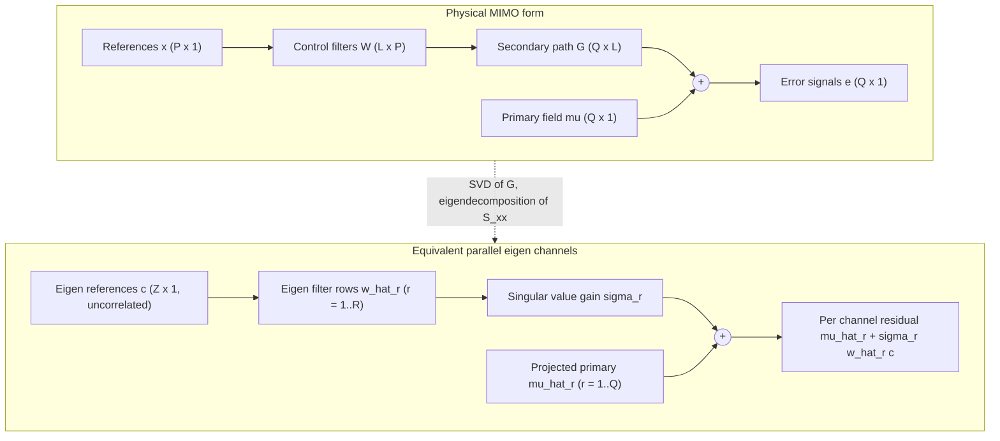

# Zhang, Murata, Maeno, Samarasinghe, Abhayapala & Mitsufuji 2020: Coherence-Based Performance Analysis on Noise Reduction in Multichannel ANC

**Authors**: [[entities/jihui-aimee-zhang|Jihui Aimee Zhang]], [[entities/naoki-murata|Naoki Murata]], [[entities/yu-maeno|Yu Maeno]], [[entities/prasanga-n-samarasinghe|Prasanga N. Samarasinghe]], [[entities/thushara-d-abhayapala|Thushara D. Abhayapala]], [[entities/yuki-mitsufuji|Yuki Mitsufuji]]
**Affiliation**: Audio and Acoustic Signal Processing Group, The Australian National University, Canberra, Australia; R&D Center, Sony Corporation, Tokyo, Japan

**Published**: Journal of the Acoustical Society of America 148(3), pp. 1519–1528, September 2020
**DOI**: [10.1121/10.0001938](https://doi.org/10.1121/10.0001938)
**📎 Zotero**: [zotero://select/items/0_38MNGBSC](zotero://select/items/0_38MNGBSC)

## Summary

This paper develops an algorithm-independent method to compute the **maximum noise reduction (NR) potential** of an arbitrary multichannel feedforward ANC system with $P$ reference microphones, $L$ secondary sources, and $Q$ error microphones. The residual error energy is decomposed, via the SVD of the secondary-path matrix and the eigendecomposition of the reference-signal PSD matrix, into three interpretable terms: a **coherence term** (the part of the primary field the references cannot linearly predict), a **filter term** (suboptimality of the control filters, zero for the closed-form optimal filter), and a **null-space term** (primary energy projected onto the uncontrollable null space of the secondary path). The classical single-channel coherence limit of Kuo & Morgan appears as the scalar special case, and the formulation reduces to a set of parallel eigen channels — the multichannel generalization of the multiple coherence function bound. Experiments in a reverberant ANU laboratory validate the formulation and demonstrate its use as a design tool for constrained microphone/loudspeaker configurations.

## Problem Formulation

For a multichannel feedforward ANC system, in the frequency domain (wavenumber $k = 2\pi f/c$):

$$
\mathbf{e}(k) = \boldsymbol{\mu}(k) + \mathbf{G}(k)\,\mathbf{W}(k)\,\mathbf{x}(k)
$$

where $\mathbf{x}$ ($P \times 1$) are the reference signals, $\boldsymbol{\mu}$ ($Q \times 1$) the primary noise field at the error microphones, $\mathbf{G}$ ($Q \times L$) the acoustic transfer function (ATF) matrix from secondary sources to error microphones, and $\mathbf{W}$ ($L \times P$) the adaptive filter matrix. The **total energy of the residual error** (sum of error-signal PSDs) is

$$
E_T = \mathbb{E}\{\mathbf{e}^H\mathbf{e}\} = \mathbb{E}\{\boldsymbol{\mu}^H\boldsymbol{\mu}\} + \mathbb{E}\{\boldsymbol{\mu}^H\mathbf{GWx}\} + \mathbb{E}\{\mathbf{x}^H\mathbf{W}^H\mathbf{G}^H\boldsymbol{\mu}\} + \mathbb{E}\{\mathbf{x}^H\mathbf{W}^H\mathbf{G}^H\mathbf{GWx}\}.
$$

The goal is to characterize the minimum achievable $E_T$ — the fundamental NR limit — for a **given** system (fixed transducer numbers, positions, and noise field), *independently of any adaptive algorithm* (step size, iteration count, convergence behavior). Prior art either evaluated specific adaptive implementations, assumed the reference signals fully correlated with the primary signals, or treated only the single-channel coherence limit.

## Methodology

### Step 1: SVD of the secondary path

The secondary path is decomposed as

$$
\mathbf{G} = \mathbf{A}\mathbf{R}\mathbf{B}^H,
$$

with $\mathbf{A}$ ($Q \times Q$) and $\mathbf{B}$ ($L \times L$) unitary, and $\mathbf{R}$ ($Q \times L$) rectangular diagonal with $R = \mathrm{rank}(\mathbf{G}) \le \min(Q, L)$ nonzero singular values $\sigma_r$.

### Step 2: Eigendecomposition of the reference PSD matrix

The reference PSD matrix $\mathbf{S}_{xx} = \mathbb{E}\{\mathbf{x}\mathbf{x}^H\}$ (generally ill-conditioned because the references are correlated) is decomposed as $\mathbf{S}_{xx} = \mathbf{U}\mathbf{K}\mathbf{U}^H$ with $Z \le P$ nonzero eigenvalues $k_z$. Writing $\hat{\mathbf{U}} = [\mathbf{u}_1, \dots, \mathbf{u}_Z]$, the references are expressed as $\mathbf{x} = \hat{\mathbf{U}}\mathbf{c}$, where the **eigen components** $\mathbf{c} = \hat{\mathbf{U}}^H\mathbf{x}$ are mutually *uncorrelated*: $\mathbb{E}\{\mathbf{c}\mathbf{c}^H\} = \hat{\mathbf{K}} = \mathrm{diag}(k_1, \dots, k_Z)$.

### Step 3: Parallel-channel decomposition

Substituting both decompositions converts the MIMO processing into **parallel eigen channels**: each eigen channel $r$ carries the projected primary signal $\hat{\mu}_r = \mathbf{a}_r^H\boldsymbol{\mu}$, is filtered by one row $\hat{\mathbf{w}}_r$ of the transformed filter $\hat{\mathbf{W}} = \mathbf{B}^H\mathbf{W}\hat{\mathbf{U}}$, and is scaled by the singular value $\sigma_r$:

### Theorem 1: Three-term decomposition of the residual energy

With $\hat{\mu}_r = \mathbf{a}_r^H\boldsymbol{\mu}$, cross-PSD row vector $\mathbf{S}_{\hat{\mu}_r c} = \mathbb{E}\{\hat{\mu}_r\mathbf{c}^H\} = \mathbf{a}_r^H\mathbf{S}_{mx}\hat{\mathbf{U}}$, and auto-PSD $S_{\hat{\mu}_r\hat{\mu}_r} = \mathbf{a}_r^H\mathbf{S}_{mm}\mathbf{a}_r$ (all pre-measurable), the total residual energy is

$$
E_T = E_{T1} + E_{T2} + E_{T3},
$$

$$
E_{T1} = \sum_{r=1}^{R} \left( 1 - \frac{\mathbf{S}_{\hat{\mu}_r c}\,\hat{\mathbf{K}}^{-1}\,\mathbf{S}_{\hat{\mu}_r c}^H}{S_{\hat{\mu}_r\hat{\mu}_r}} \right) S_{\hat{\mu}_r\hat{\mu}_r}
= \sum_{r=1}^{R} \left( 1 - \sum_{z=1}^{Z} C_{\hat{\mu}_r c_z} \right) S_{\hat{\mu}_r\hat{\mu}_r},
$$

$$
E_{T2} = \sum_{r=1}^{R} |\sigma_r|^2 \left( \hat{\mathbf{w}}_r + \frac{\mathbf{S}_{\hat{\mu}_r c}\,\hat{\mathbf{K}}^{-1}}{\sigma_r} \right) \hat{\mathbf{K}} \left( \hat{\mathbf{w}}_r + \frac{\mathbf{S}_{\hat{\mu}_r c}\,\hat{\mathbf{K}}^{-1}}{\sigma_r} \right)^H,
$$

$$
E_{T3} = \sum_{r=R+1}^{Q} S_{\hat{\mu}_r\hat{\mu}_r}.
$$

The three terms have distinct physical meanings:

1. **Signal coherence** ($E_{T1}$): for each secondary-path eigen channel $r$, the fraction of primary energy *not linearly explainable* by the reference eigen components, weighted by $S_{\hat{\mu}_r\hat{\mu}_r}$. The per-channel coherence is
   $$
   C_{\hat{\mu}_r c_z} = \frac{|S_{\hat{\mu}_r c_z}|^2}{S_{\hat{\mu}_r\hat{\mu}_r}\,k_z} = \frac{|\mathbf{a}_r^H\mathbf{S}_{mx}\mathbf{u}_z|^2}{\mathbf{a}_r^H\mathbf{S}_{mm}\mathbf{a}_r\,k_z},
   $$
   and $\sum_z C_{\hat{\mu}_r c_z}$ is the multiple coherence between $\hat{\mu}_r$ and the $Z$ uncorrelated eigen references — so $E_{T1}$ is the eigen-channel-weighted generalization of the classical coherence bound.
2. **Filter** ($E_{T2}$): the $\hat{\mathbf{K}}$-weighted distance of the transformed filter rows from the optimum — it vanishes exactly when the filters are optimal.
3. **System null space** ($E_{T3}$): primary energy projected onto directions of the error-microphone space that the secondary sources cannot reach ($r > R$). No filter can control it; it caps the NR of the *configuration itself*.

### Closed-form optimal filter

Setting $E_{T2} = 0$ (equivalently $\partial E_T / \partial \mathbf{W}^* = \mathbf{0}$, proven via the complex gradient operator) yields the per-channel optimal filter

$$
\hat{\mathbf{w}}_r^{o} = -\,\frac{\mathbf{S}_{\hat{\mu}_r c}\,\hat{\mathbf{K}}^{-1}}{\sigma_r}
= -\,\frac{\mathbf{a}_r^H\mathbf{S}_{mx}\hat{\mathbf{U}}\hat{\mathbf{K}}^{-1}}{\sigma_r},
\qquad
\hat{w}_{rz}^{o} = -\,\frac{S_{\hat{\mu}_r c_z}}{\sigma_r\,k_z},
$$

stacked into $\hat{\mathbf{W}}_o^{up}$ ($R \times Z$) and mapped back to the physical domain via

$$
\mathbf{W}_o = \hat{\mathbf{B}}\,\hat{\mathbf{W}}_o^{up}\,\hat{\mathbf{U}}^H,
\qquad \hat{\mathbf{B}} = [\mathbf{b}_1, \dots, \mathbf{b}_R].
$$

### Special case: single-channel ANC

For $Q = P = L = 1$ (with secondary path gain $g$), Theorem 1 collapses to

$$
E_T = (1 - C_{\mu x})\,S_{\mu\mu} + \left| g w + \frac{S_{\mu x}}{S_{xx}} \right|^2 S_{xx},
\qquad C_{\mu x} = \frac{|S_{\mu x}|^2}{S_{xx} S_{\mu\mu}},
$$

so with the optimal filter $w^o = -S_{\mu x}/(g S_{xx})$ the minimum residual depends only on the reference–primary coherence — recovering the classical single-channel result of Kuo & Morgan (1996). The maximum NR is therefore

$$
\mathrm{NR}_{\max}(f) = -10\log_{10}\frac{E_{T1} + E_{T3}}{E_{\mathrm{pri}}},
$$

independent of the adaptive algorithm. The theory also extends to feedback ANC by replacing the reference signals with synthesized reference signals.

## Experimental Setup

| Item | Value |
|------|-------|
| **Venue** | Audio laboratory, Australian National University (reverberant room) |
| **Primary sources** | 2 × Tannoy System 600 floorstanding loudspeakers, driven by two uncorrelated broadband engine-noise recordings (energy dominant in 50–500 Hz) |
| **Secondary sources** | 4 of 30 small loudspeakers of a spherical array (Grover Notting CR1) |
| **Microphones** | Dayton Audio EMM-6 electret measurement microphones; error mics at the center of the spherical array, reference mics between secondary sources and primary sources |
| **Sampling / STFT** | $f_s$ = 48 kHz; frame length = FFT length = 9216 samples, Hann window, 50% overlap; blockwise frequency-domain processing |
| **Evaluated band** | 100–500 Hz |
| **Cases** | Case 1: $P{=}4$, $Q{=}4$, $L{=}4$ · Case 2: $P{=}4$, $Q{=}9$, $L{=}4$ (five more error mics) · Case 3: $P{=}1$, $Q{=}4$, $L{=}4$ (three fewer reference mics) |
| **Adaptive baseline** | Normalized frequency-domain FxLMS (Kosaka, Elliott & Boucher 1997), filtering and update in the frequency domain, one frame per iteration, 48 iterations |
| **Metrics** | $\mathrm{NR} = -10\log_{10}(E_T/E_{\mathrm{pri}})$; component contributions $\mathrm{CO}_j = -10\log_{10}(E_{Tj}/E_{\mathrm{pri}})$, $E_{\mathrm{pri}} = \sum_q \mathbb{E}\{|\mu_q|^2\}$ |

## Results

1. **Formulation validation (case 2)**: with the *same* filter $\mathbf{W}$, the proposed decomposition (Theorem 1) and the direct energy expression give identical residuals — the corresponding NR curves merge exactly, confirming the parallel-channel transformation is lossless.
2. **Optimal vs. adaptive**: the NR from the statistical optimal filter $\mathbf{W}_o$ is slightly higher than that of the adaptive FxLMS filter after 48 iterations, as expected, since the adaptive solution is affected by the algorithm, iteration count, step size, and noise-signal stationarity. The proposed method gives the *statistical* maximum NR directly, without running any adaptation.
3. **Component attribution (case 2)**: the coherence term $E_{T1}$ contributes more to the residual energy than the null-space term $E_{T3}$; the filter term $E_{T2}$ is zero under the optimal filter and nonzero under the adaptive filter.
4. **Configuration comparison**: maximum NR ranks case 1 > case 2 > case 3. In case 3 ($P = 1$), the reference-starved system's NR is much lower than the other two cases — the coherence limit dominates. In cases 1 and 3, $\mathrm{rank}(\mathbf{G}) = Q$, so $E_{T3} = 0$ and $E_{T1}$ is the only contributor to the minimum residual. In case 2 ($Q > L$), the null-space term contributes significantly — comparable to the coherence term — quantifying the penalty of having more error microphones than controllable secondary directions.
5. **Design application**: the formulation predicts the contributions of each component for a candidate configuration, enabling offline optimization of the numbers/positions of secondary loudspeakers and reference microphones under placement constraints (e.g., the office-room scenario of Fig. 1: error mics on a meeting table, constrained loudspeaker/reference placement along walls).

## Key Contributions

1. **Algorithm-independent NR potential**: first mathematical formulation of the maximum noise reduction for *any arbitrary* multichannel feedforward ANC system, expressed purely from pre-measurable statistics ($\mathbf{S}_{mx}$, $\mathbf{S}_{mm}$, $\mathbf{S}_{xx}$) and the secondary-path matrix $\mathbf{G}$ — no adaptive algorithm needs to be run.
2. **Three-term residual-energy decomposition** ($E_{T1}$ coherence / $E_{T2}$ filter / $E_{T3}$ null space), obtained by combining the SVD of the secondary path with the eigendecomposition of the reference PSD matrix, which turns the MIMO system into parallel eigen channels and attributes the residual to interpretable physical causes.
3. **Closed-form optimal control filter** in the transformed domain ($\hat{w}_{rz}^o = -S_{\hat{\mu}_r c_z}/(\sigma_r k_z)$), derived both by completing the square and independently by complex-matrix differentiation.
4. **Unification with the classical bound**: the single-channel coherence limit of Kuo & Morgan (1996) is proven to be the scalar special case of Theorem 1, making it the multichannel/multi-error generalization of the coherence-based NR bound (cf. the [[concepts/multiple-coherence-function|multiple coherence function]]).
5. **Configuration-design tool**: experimental demonstration that the decomposition predicts how reference starvation (case 3) and error-microphone surplus over secondary sources (case 2) each limit the achievable NR — directly usable for transducer placement/count optimization.

## Limitations

- Feedforward formulation; feedback ANC is covered only by substituting synthesized reference signals, and **acoustic feedback from the secondary sources to the reference microphones is not modeled** (listed as future work — cf. [[sources/zhang-2026-feedback-path-mitigation-mcanc|the follow-up line of work on multichannel feedback mitigation]]).
- NR is evaluated at the discrete error-microphone positions, not over a continuous spatial region (also future work).
- Requires stationary-environment statistics ($\mathbf{S}_{mx}$, $\mathbf{S}_{mm}$, $\mathbf{S}_{xx}$) and the secondary-path ATF matrix to be measurable/estimable.
- Experiments use measured transfer functions and real engine-noise recordings, but no physical real-time ANC hardware demonstration of the predicted bounds is reported beyond the frequency-domain FxLMS comparison.

## Related Concepts

- [[concepts/anc-nr-potential-decomposition|ANC NR-Potential Decomposition]] — the $E_{T1}/E_{T2}/E_{T3}$ framework introduced by this paper
- [[concepts/multi-channel-anc|Multi-Channel ANC]]
- [[concepts/broad-band-feedforward-anc|Broad-Band Feedforward ANC]]
- [[concepts/multiple-coherence-function|Multiple Coherence Function (MCF)]]
- [[concepts/anc-attenuation-bounds|ANC Attenuation Bounds]]
- [[concepts/singular-value-decomposition|Singular Value Decomposition]]
- [[concepts/spatial-coherence|Spatial Coherence]]

## Related Synthesis

- [[synthesis/multichannel-anc-efficiency-and-robustness|Multichannel ANC: Computational Efficiency and Spatial Robustness]] — this paper contributes the *fundamental-limit prediction* axis (how much NR is achievable at all), complementary to the efficiency (how cheaply) and robustness (how stably) axes
