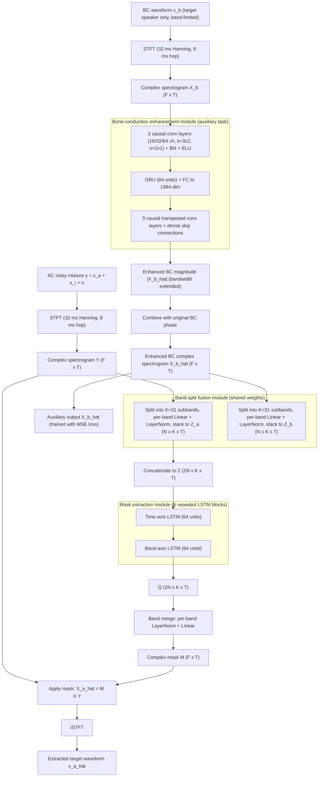

# Zhang, Feng, Liu, Zhang & Li 2025: MBENet — Bone-Conduction and Air-Conduction Fusion Network for Target Speaker Extraction

- **Authors**: [[entities/chen-zhang|Chen Zhang]], [[entities/linfeng-feng|Linfeng Feng]], [[entities/zhi-liu|Zhi Liu]], [[entities/xiao-lei-zhang|Xiao-Lei Zhang]] (corresponding), [[entities/xuelong-li|Xuelong Li]] (corresponding)
- **Affiliations**: School of Marine Science and Technology, Northwestern Polytechnical University, Xi'an, China; Institute of Artificial Intelligence (TeleAI), China Telecom; R&D Institute of NWPU in Shenzhen; Shenzhen Huangli Technologies
- **Venue**: ASRU 2025 — IEEE Automatic Speech Recognition and Understanding Workshop
- **Year**: 2025
- **Type**: Conference Paper
- **DOI**: [10.1109/ASRU65441.2025.11434606](https://doi.org/10.1109/ASRU65441.2025.11434606)
- **Zotero**: [Open in Zotero](zotero://select/items/0_H9ZMR9P4)

## Summary

This paper proposes **MBENet** (Multi-modal Bone-conduction Enhancement Network), the first BC-AC fusion model applied to target speaker extraction (TSE). BC signals (skull vibration, noise-immune, target-speaker-only, but band-limited) replace the conventional enrollment utterance as the speaker cue, while the noisy AC mixture supplies high-frequency content. MBENet fuses both modalities through a shared-weight band-split module (BSRNN-style, 31 subbands) and a dual-axis LSTM mask extractor, and introduces **multi-task learning**: BC-channel bandwidth extension is trained as an auxiliary task (MSE loss on the BC magnitude spectrogram) alongside the SI-SDR loss of the final extracted speech, with $\gamma = 15$. The fully causal model (3.8M parameters, same as pBSRNN) outperforms all baselines across all SNR conditions on the simulated ABCS-2Mix dataset, with growing margins at lower SNR (e.g., PESQ +6.03% over pBSRNN at −5 dB).

## Problem Formulation

The TSE task uses bone-conducted speech as the auxiliary cue for isolating the target speaker from a noisy two-speaker mixture. The signal model:

$$
(\hat{\mathbf{x}}_{a}, \hat{\mathbf{X}}_{b}) = \mathrm{MBENet}(\mathbf{x}_{b}, \mathbf{y})
$$

where the noisy AC mixture is $\mathbf{y} = \mathbf{x}_{a} + \mathbf{x}_{i} + \mathbf{n}$ (target speech + interference speech + background noise), and $\mathbf{x}_{b}$ is the **clean bone-conducted signal containing only the target speaker's low-frequency content**. The model outputs both the estimated target waveform $\hat{\mathbf{x}}_{a} \in \mathbb{R}^{T_w}$ and the estimated wideband BC complex spectrogram $\hat{\mathbf{X}}_{b} \in \mathbb{R}^{F \times T}$ (the auxiliary task output).

Key asymmetry vs. conventional TSE: in enrollment-based TSE the speaker cue is a separate clean utterance of *unknown* acoustic condition; here the BC channel is a *concurrent, noise-robust* observation of the target — it filters out both background noise and interfering speakers, but only below its limited bandwidth.

## Methodology

![[raw/papers/zhang-2025-mbenet/figures/1f84b2ddce5bcdacfe7939cae85cf6472c80395ae1cbb27fe9c2503b979b331a.jpg|MBENet overview (A)]]

![[raw/papers/zhang-2025-mbenet/figures/d98c7dd6379dfbfec35c6ae25c33910275ed54710f5e415fa7ebc0d09e5eb3df.jpg|MBENet overview (B)]]

*Figure 1: Overall architecture of MBENet — (A) overview: bone-conduction enhancement module for bandwidth extension; (B) band-split based fusion module for BC-AC fusion; (C) mask extraction module and signal reconstruction.*

### A. Overall Pipeline

MBENet consists of three modules:

1. **Bone-conduction enhancement module** — extends the bandwidth of the BC signal's complex spectrogram $\mathbf{X}_b$, producing $\hat{\mathbf{X}}_b$ with high-frequency components (the auxiliary task). Inspired by audio super-resolution; inherits the CRN encoder-decoder paradigm. Its output magnitude is combined with the **original BC phase** to form the complete enhanced complex spectrogram fed forward.
2. **Band-split fusion module** — both $\mathbf{Y}$ (AC) and $\hat{\mathbf{X}}_b$ (enhanced BC) are processed through a **shared-weight** [[concepts/band-split-rnn|band-split]] module (from BSRNN): the spectrogram is split into $K = 31$ subbands, each processed by a linear layer + layer normalization, then stacked into 3-D tensors $\mathbf{Z}_a, \mathbf{Z}_b \in \mathbb{R}^{N \times K \times T}$, and concatenated to $\mathbf{Z} \in \mathbb{R}^{2N \times K \times T}$.
3. **Mask extraction module** — dual-axis LSTM modeling: the first block models the time sequence along the time axis; the second captures context among frequency bands per frame. The stacked bands $\mathbf{Z}$ map to $\mathbf{Q} \in \mathbb{R}^{2N \times K \times T}$, then undergo **band merging** (inverse of band split): per-subband layer norm + linear, producing the complex mask $\mathbf{M} \in \mathbb{R}^{F \times T}$. The estimated clean spectrogram is $\hat{\mathbf{X}}_a = \mathbf{M} \odot \mathbf{Y}$ (Hadamard product), reconstructed to waveform via iSTFT.

### B. Bone-Conduction Enhancement Module

![[raw/papers/zhang-2025-mbenet/figures/5c0a68fe0d9c91beaa5932ddbfacc37261a8c7a00a46fb98fa2bd8478122041f.jpg|Bone-conduction enhancement module]]

*Figure 2: Detailed structure of the bone-conduction enhancement module — causal conv encoder / GRU bottleneck / transposed-conv decoder with dense skip connections.*

A symmetric [[concepts/convolutional-recurrent-network|CRN]]-style encoder-decoder:

- **Encoder**: 3 causal convolutional layers (output channels {16, 32, 64}; kernel (3,2), stride (2,1))
- **Bottleneck**: 1 GRU layer (64 hidden units) + fully-connected layer projecting 64-dim hidden states to 1984-dim
- **Decoder**: 3 causal transposed convolutional layers mirroring the encoder
- ELU activations on all conv/transposed-conv layers except the final output layer; batch normalization between each convolution and its activation
- **Dense skip connections** by channelwise concatenation of encoder outputs to corresponding decoder inputs

The module enhances **only the magnitude** of the BC signal; the enhanced magnitude is combined with the original BC phase spectrum to form the complex spectrogram sent to the fusion module.

### Model Structure, Inputs, and Outputs

| Spec | Bone-conduction enhancement module | Band-split fusion module | Mask extraction module |
|------|-------------------------------------|--------------------------|-------------------------|
| **Structure** | 3 causal conv enc (16/32/64 ch) → GRU(64) + FC(1984) → 3 causal transposed-conv dec, dense skips, BN+ELU | Shared-weight band split into 31 subbands, per-band Linear + LayerNorm | 6 repeated dual-axis LSTM blocks (time-axis LSTM 64 units + band-axis LSTM 64 units) |
| **Input** | BC complex spectrogram $\mathbf{X}_b$ (32 ms Hanning window, 8 ms hop, 16 kHz) | AC spectrogram $\mathbf{Y}$ + enhanced BC spectrogram $\hat{\mathbf{X}}_b$ | Concatenated bands $\mathbf{Z} \in \mathbb{R}^{2N \times K \times T}$ |
| **Output** | Enhanced BC magnitude → complex spectrogram with original BC phase | Band tensors $\mathbf{Z}_a, \mathbf{Z}_b \in \mathbb{R}^{N \times K \times T}$ → concat $\mathbf{Z}$ | Complex mask $\mathbf{M} \in \mathbb{R}^{F \times T}$ → masked $\hat{\mathbf{X}}_a$ → waveform via iSTFT |
| **Training data** | ABCS-2Mix (80,225 training mixtures, 3 s segments) | same | same |
| **Role** | BC bandwidth extension (auxiliary task); makes BC spectral content comparable to AC for fusion | Cross-modal feature alignment via shared per-band projections | Joint temporal/spectral context modeling and mask estimation for final extraction |

**Causality**: the model is fully causal (causal convolutions, GRU/LSTM sequence models) — suited for streaming/real-time deployment.

### Training Losses

Multi-task hybrid loss:

$$
\mathcal{L}_{hybrid} = \mathcal{L}_{sisdr} + \gamma \mathcal{L}_{mse}, \quad \gamma = 15
$$

- **SI-SDR loss** (final TSE task, computed on $\hat{\mathbf{x}}_a$):

$$
\mathcal{L}_{sisdr} = -10 \log_{10} \frac{\|\bar{\mathbf{x}}_a\|_2^2}{\|\bar{\mathbf{x}}_a - \hat{\mathbf{x}}_a\|_2^2}, \quad \bar{\mathbf{x}}_a = \frac{\hat{\mathbf{x}}_a^T \mathbf{x}_a}{\|\mathbf{x}_a\|_2^2}
$$

- **MSE loss** (auxiliary bandwidth-extension task, on the BC magnitude spectrogram $|\hat{\mathbf{X}}_b|$, target $|\mathbf{X}_a|$):

$$
\mathcal{L}_{mse} = \frac{1}{T \times F} \big| |\mathbf{X}_a(i)| - |\hat{\mathbf{X}}_b(i)| \big|_2^2
$$

The auxiliary task trains the BC enhancement module to reconstruct the **clean target speech magnitude** (wideband) from the band-limited BC input — the "blind enhancement" target — while the fusion path learns to exploit the extended-band BC features for extraction. Note the auxiliary target is the clean AC speech magnitude $\mathbf{X}_a$, not the raw BC signal.

## Experimental Setup

| Parameter | Value |
|-----------|-------|
| **Dataset** | Simulated **ABCS-2Mix** — built from the multimodal Mandarin corpus **ABCS** (100 native Chinese speakers, 50 M / 50 F; synchronized AC + BC channels per utterance) + MUSAN noise |
| **Speaker split** | Train 40 M + 40 F; val 5 M + 5 F; test 5 M + 5 F |
| **Mixture construction** | Random target + interfering utterance; clean-mixture SIR ∈ [0, 2] dB; MUSAN noise, SNR ~ N(−5…10 dB range) |
| **Subsets** | 80,225 train / 13,650 dev / 13,650 test mixtures; training segments chopped to 3 s |
| **Sampling rate** | 16 kHz |
| **STFT** | 32 ms Hanning window, 8 ms hop (75% overlap) |
| **Band split** | 31 subbands |
| **Mask-extraction LSTM** | 2 LSTMs (time-axis + band-axis), 64 hidden units each, 6 repetitions |
| **Optimizer** | AdamW, lr $10^{-3}$, halved after 2 epochs without validation improvement |
| **Early stopping** | 5 consecutive epochs without best validation model |
| **Gradient clipping** | 5 |
| **Loss weight** | $\gamma = 15$ (MSE term) |
| **Metrics** | SI-SDR, PESQ (intrusive); DNSMOS SIG/BAK/OVRL (non-intrusive) |
| **Parameters** | 3.8 M (same as pBSRNN) |

**Baselines** (adapted, since no prior AC-BC fusion TSE model existed):

- **CRN** (Tan & Wang 2018): SE model adapted to TSE by replacing direct magnitude prediction with a mask-embedding branch; AC + BC concatenated as input
- **SpEx+** (Ge et al. 2020): time-domain TSE with the target's BC signal replacing the registered enrollment utterance
- **MMINet** (Wang et al. 2022): time-domain AC-BC fusion SE model
- **pBSRNN** (Yu et al. 2023): T-F-domain TSE with BC signal replacing the registered enrollment utterance
- Ablations: **AC MBENet** (AC-only, speaker-embedding-based per [26]) and **MNet** (MBENet without the BC enhancement module)

## Results

### Intrusive metrics (Table I, average over SNRs; SI-SDR dB / PESQ)

| Method | Params (M) | −5 dB | 0 dB | 5 dB | 10 dB | Average |
|--------|-----------:|------:|-----:|-----:|------:|--------:|
| Noisy AC | — | 0.82 / 2.00 | 0.92 / 2.17 | 1.35 / 2.34 | 1.68 / 2.48 | 1.20 / 2.25 |
| CRN | 1.6 | 7.88 / 2.31 | 9.77 / 2.43 | 11.57 / 2.64 | 13.11 / 2.79 | 10.58 / 2.54 |
| SpEx+ | 11.1 | 11.97 / 2.67 | 14.21 / 2.79 | 16.44 / 3.05 | 17.63 / 3.17 | 15.06 / 2.91 |
| MMINet | 5.2 | 13.10 / 2.69 | 14.70 / 2.81 | 17.10 / 3.04 | 18.31 / 3.13 | 15.81 / 2.92 |
| pBSRNN | 3.8 | 12.74 / 2.82 | 14.90 / 2.91 | 17.20 / 3.11 | 18.24 / 3.29 | 15.77 / 3.03 |
| **MBENet** | 3.8 | **13.52 / 2.99** | **15.80 / 3.08** | **17.94 / 3.23** | **19.36 / 3.38** | **16.67 / 3.17** |

MBENet outperforms all baselines on both metrics at every SNR. The PESQ margin over pBSRNN (same 3.8M params) **grows as SNR drops**: 2.74% (10 dB) → 3.86% (5 dB) → 5.84% (0 dB) → 6.03% (−5 dB) — demonstrating the noise robustness conferred by the BC modality. The auxiliary-task gain comes with only a minimal parameter increase over pBSRNN.

### Non-intrusive metrics (Table II, DNSMOS, average over SNRs; SIG/BAK/OVRL)

| Method | −5 dB | 0 dB | 5 dB | 10 dB | Average |
|--------|------:|-----:|-----:|------:|--------:|
| Noisy AC | 1.66 / 1.37 / 1.40 | 1.66 / 1.37 / 1.40 | 1.66 / 1.37 / 1.40 | 1.66 / 1.37 / 1.40 | 1.66 / 1.37 / 1.40 |
| CRN | 2.25 / 2.08 / 1.85 | 2.25 / 2.08 / 1.85 | 2.25 / 2.08 / 1.85 | 2.25 / 2.08 / 1.85 | 2.25 / 2.08 / 1.85 |
| SpEx+ | 3.46 / 3.22 / 3.09 | 3.46 / 3.22 / 3.09 | 3.46 / 3.22 / 3.09 | 3.46 / 3.22 / 3.09 | 3.46 / 3.22 / 3.09 |
| MMINet | 3.38 / 3.65 / 3.27 | 3.38 / 3.65 / 3.27 | 3.38 / 3.65 / 3.27 | 3.38 / 3.65 / 3.27 | 3.38 / 3.65 / 3.27 |
| pBSRNN | 3.39 / 3.68 / 3.29 | 3.39 / 3.68 / 3.29 | 3.39 / 3.68 / 3.29 | 3.39 / 3.68 / 3.29 | 3.39 / 3.68 / 3.29 |
| **MBENet** | **3.60 / 3.86 / 3.47** | **3.60 / 3.86 / 3.47** | **3.60 / 3.86 / 3.47** | **3.60 / 3.86 / 3.47** | **3.60 / 3.86 / 3.47** |

(Values shown are the average column of Table II; MBENet leads all baselines on SIG, BAK, and OVRL at every SNR, consistent with the intrusive metrics.)

### Ablation: BC-AC fusion vs. AC-only (Table III)

| System | SI-SDR | PESQ | SIG | BAK | OVRL |
|--------|-------:|-----:|----:|----:|-----:|
| Noisy AC speech | 1.20 | 2.15 | 1.66 | 1.37 | 1.40 |
| BC speech (raw) | 8.81 | 2.95 | 3.10 | 2.62 | 2.50 |
| AC MBENet (speaker-embedding cue) | 11.19 | 2.68 | 2.77 | 2.51 | 2.39 |
| MNet (no BC enhancement module) | 16.12 | 3.03 | 3.79 | 3.57 | 3.39 |
| **MBENet (full)** | **16.67** | **3.17** | **3.86** | **3.60** | **3.47** |

Key observations:

- **BC-AC fusion ≫ AC-only**: MBENet gains +5.48 dB SI-SDR and +0.49 PESQ over the AC-only MBENet with speaker-embedding cue — the BC modality is far more informative than an enrollment embedding under this noise regime (SIR 0–2 dB, SNR −5…10 dB).
- **The BC enhancement module matters**: MNet → MBENet (adding bandwidth extension as auxiliary task) adds +0.55 dB SI-SDR / +0.14 PESQ — the multi-task bandwidth extension is not merely a training trick but feeds spectrally richer BC features into fusion.
- **Raw BC speech** alone already achieves 8.81 dB SI-SDR / 2.95 PESQ (its interference-free nature), but suffers poor auditory quality from severe high-frequency loss — the fusion model surpasses it substantially while keeping intelligibility.

## Key Contributions

1. **First BC-AC fusion model for TSE**: MBENet is the first causal end-to-end framework applying BC-AC fusion to target speaker extraction, replacing the enrollment-utterance clue with the noise-robust, target-speaker-only BC signal (prior BC-AC fusion work addressed only speech enhancement).
2. **Multi-task learning via BC bandwidth extension**: the BC channel's bandwidth extension is trained as an auxiliary task (MSE on magnitude, $\gamma = 15$) alongside the SI-SDR extraction loss — the auxiliary task improves the fused representation, yielding significant gains at minimal parameter cost (3.8M, tied with pBSRNN).
3. **Shared-weight band-split fusion**: AC and enhanced-BC spectrograms are split into 31 subbands by a shared-weight band-split module (BSRNN-style) before concatenation, enabling precise per-band cross-modal modeling; a dual-axis (time/band) LSTM stack with band-merge mask decoder produces the complex mask.
4. **Empirical evidence of BC superiority as a TSE cue in noise**: the margin over pBSRNN grows monotonically as SNR decreases (PESQ +2.74% → +6.03% from 10 dB → −5 dB), and the ablation shows BC-cue MBENet beating speaker-embedding AC-only MBENet by +5.48 dB SI-SDR.

## Related Concepts

- [[concepts/mbenet|MBENet]]
- [[concepts/target-speaker-extraction|Target Speaker Extraction]]
- [[concepts/bone-conduction|Bone Conduction]]
- [[concepts/bcs-guided-speech-enhancement|BCS-Guided Speech Enhancement]]
- [[concepts/band-split-rnn|Band-Split RNN (BSRNN)]]
- [[concepts/blind-bandwidth-extension|Blind Bandwidth Extension]]
- [[concepts/convolutional-recurrent-network|Convolutional Recurrent Network]]
- [[concepts/cocktail-party-problem|Cocktail-Party Problem]]
- [[concepts/speaker-embedding|Speaker Embedding]]
- [[concepts/si-sdr|SI-SDR]]
- [[concepts/pesq|PESQ]]

## Related Sources

- [[sources/zmolikova-2023-neural-target-speech-extraction-overview|Zmolikova et al. 2023: Neural Target Speech Extraction: An Overview]] — surveys the TSE framework MBENet extends with a new cue type
- [[sources/wang-2022-fusing-bc-ac-complex-domain-se|Wang, Zhang & Wang 2022: Fusing BC and AC Sensors for Complex-Domain Speech Enhancement]] — BC-AC fusion in SE (not TSE)
- [[sources/liu-2025-robust-fusion-bc-ac-attention|Liu, Chen & Yin 2025: Robust BC/AC Fusion with ATFA]] — contemporary BC-AC SE fusion
- [[sources/luo-2022-band-split-rnn|Luo & Yu 2022: Music Source Separation with Band-Split RNN]] — the band-split architecture MBENet adapts
- [[sources/heitkaemper-2025-bcs-speech-enhancement-earbuds|Heitkaemper et al. 2025: BCS-Guided Speech Enhancement for Earbuds]] — BCS as auxiliary for SE/ASR on earbuds
- [[sources/kuang-2024-lightweight-speech-enhancement-bone-air|Kuang, Yang & Yang 2024: Lightweight BC/AC Speech Enhancement]]

## Related Synthesis

- [[synthesis/multimodal-bc-speech-enhancement|Multimodal Smart Hearables: BC-Aided Speech Enhancement]]
- [[synthesis/multi-modal-speech-enhancement|Multi-Modal Speech Enhancement]]
