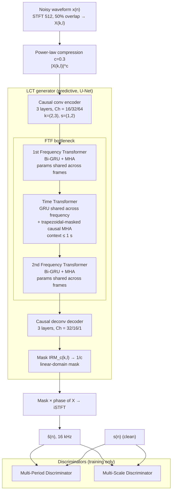

# Zhao & Madhu 2025: Study of Lightweight Transformer Architectures for Single-Channel Speech Enhancement

**Authors**: [[entities/haixin-zhao|Haixin Zhao]], [[entities/nilesh-madhu|Nilesh Madhu]]
**Institution**: IDLab, Department of Electronics and Information Systems, Ghent University — imec, Ghent, Belgium
**Venue**: 33rd European Signal Processing Conference (EUSIPCO 2025); preprint arXiv:2505.21057
**Year**: 2025
**Type**: Conference paper
**DOI**: [10.23919/EUSIPCO63237.2025.11226622](https://doi.org/10.23919/EUSIPCO63237.2025.11226622)
**Zotero**: [LA85IGID](zotero://select/items/0_LA85IGID)
**Demos**: [aspire.ugent.be/demos/EUSIPCO2025HZ](https://aspire.ugent.be/demos/EUSIPCO2025HZ/)

## Summary

The paper attacks the cost of interleaved temporal/spectral modelling in lightweight speech enhancement with a systematic ablation over transformer bottleneck arrangements, and concludes that a **Frequency–Time–Frequency (FTF)** stack is the efficient frontier: it exploits global dependencies causally while using far less compute than stacking more modules. Two structural tricks make it cheap — parameter sharing along the *non-modelled* dimension (GRU shared across frequency in the time transformer, frequency-transformer weights shared across frames) and a **trapezoidal causal mask** that bounds attention context to 1 s, so complexity is independent of utterance length. Combined with multi-scale and multi-period waveform discriminators (inference-free cost), the resulting **LCT-GAN** reaches 3.06 PESQ / 3.80 COVL on VoiceBank+DEMAND with **0.14 M parameters and 0.35 G MAC/s** — ~6% of DeepFilterNet2's parameters at similar complexity and quality — and 3.20 PESQ with perceptual contrast stretching, matching DeepFilterNet3.

## Problem Formulation

The microphone signal is modelled additively as $x(n) = s(n) + v(n)$ (target speech + noise). The generator predicts a **real-valued** STFT mask $\widehat{M}(k,l)$ applied to $X(k,l)$, followed by inverse STFT to yield $\widehat{s}(n)$; the distorted phase is retained. Its training target is the compressed-domain ideal ratio mask

$$
\widehat{\mathrm{IRM}}_{c}(k,l)=\frac{\lvert S(k,l)\rvert^{c}}{\lvert X(k,l)\rvert^{c}+\gamma},
$$

with frequency bin $k$, frame index $l$, regularisation constant $\gamma$, and compression factor $c=0.3$ (chosen to sharpen mask estimation for low-energy speech components). The linear-domain mask is recovered by exponentiating with $1/c$.

The architectural question is: given a fixed lightweight U-Net budget, **how should temporal and spectral modelling be sequenced and shared** so that global context is captured without the cumulative compute of stacked transformer/RNN modules? Interleaving temporal and spectral modules is known to help quality, but naïve stacking yields diminishing returns at linear cost growth.

## Methodology

### LCT-GAN Overview

The generator ("LCT") is a predictive U-Net: a **3-layer causal convolutional encoder–decoder** with output channels $\{16,32,64\}$ (encoder) and $\{32,16,1\}$ (decoder), kernel size $(2,3)$ and stride $(1,2)$ over time/frequency, leaky ReLU ($\alpha=0.03$) after every layer except the output, and point-wise-convolution skip connections from encoder to decoder. The bottleneck is the FTF transformer stack. Discriminators are **waveform-domain**: a multi-period discriminator (long-term latent structure) and a multi-scale discriminator (periodic patterns), used only during training — inference cost is unchanged.

![[raw/papers/zhao-2025-lightweight-transformer/figures/fig1.png|Fig. 1]]

*Figure 1: LCT-GAN architecture. The generator (predictive mask estimator, dotted boundary separate from the discriminators) compresses the noisy magnitude with $c=0.3$, encodes it, processes the latent with three FTF transformers, decodes an IRM, and reconstructs via iSTFT. Adversarial losses $\mathcal{L}_{\mathrm{adv\_gen}}$ / $\mathcal{L}_{\mathrm{adv\_dis}}$ and a multi-resolution spectral loss $\mathcal{L}_{\mathrm{multi\_res}}$ train the pair; skip connections are point-wise convolutions and tensor dimensions of each transformer are annotated.*

### Model Structure, Inputs, and Outputs

| Spec | LCT-GAN generator |
|------|-------------------|
| **Structure** | U-Net, 3-layer causal conv encoder ($3{\times}3$ convs, channels 16/32/64, kernel $(2,3)$, stride $(1,2)$) → FTF bottleneck (3 transformers) → 3-layer decoder (32/16/1); point-wise-conv skip connections; leaky ReLU $\alpha=0.03$ |
| **Bottleneck** | 1st frequency transformer → time transformer → 2nd frequency transformer. Each has an RNN block (Bi-GRU for the frequency transformers, uni-directional GRU for the time transformer) and an MHA block (4 heads), each preceded by pre-norm LayerNorm and wrapped in residuals. Grouped GRUs with grouping factor 4; GRU hidden size = input channel count ($Ch=64$) |
| **Input** | Compressed noisy magnitude $\lvert X(k,l)\rvert^{c}$, $c=0.3$; STFT window 512 samples, 50% overlap, 16 kHz |
| **Output** | Compressed-domain real-valued mask $\widehat{\mathrm{IRM}}_c(k,l)$, exponentiated by $1/c$ and applied to $X(k,l)$ with the noisy phase; 32 ms algorithmic latency fully causal, 48 ms with one frame look-ahead |
| **Training data** | VoiceBank+DEMAND; DNS3 140 h synthesised wide-band (SNR −5…20 dB) |
| **Role** | Predictive denoiser; the discriminators shape its training only |

**Parameter sharing** is the load-bearing idea. Conventional GRUs flatten frequency into the feature dimension, so GRU cost grows quadratically with feature size. Here the time transformer applies **one GRU shared across all frequency bins** (tensor laid out as $(B\!\cdot\!F, T, C)$, i.e. frequency becomes the batch axis), while global spectral context is supplied by the surrounding frequency transformers whose weights are shared across all frames. Relative to the conventional GRU bottleneck of CRUSE (Braun et al. 2021), the FTF stack cuts **MACs by 27% and parameters by 98%**.

![[raw/papers/zhao-2025-lightweight-transformer/figures/fig2.png|Fig. 2]]

*Figure 2: The "ladder-shaped" information flow of the FTF bottleneck. The 1st frequency transformer exchanges information across frequency within each previous frame; the causal time transformer propagates it forward to the current frame; the 2nd frequency transformer re-exchanges the updated information across frequency, so every TF bin (marked ✕) has seen global context in both dimensions.*

**Trapezoidal causal masking**: the time transformer's MHA uses a causal mask that additionally caps the attention window at 1 s of context — a trapezoid rather than the usual lower triangle. Causality is preserved, and the cost of an attention layer stops growing with utterance length, which is what makes an attention block affordable in a streaming model at all.

### Training Losses

The generator minimises $\mathcal{L}_{G}=\mathcal{L}_{\mathrm{adv\_gen}}+\mathcal{L}_{\mathrm{multi\_res}}$; the discriminator minimises $\mathcal{L}_{\mathrm{adv\_dis}}$. Adversarial terms are least-squares (LSGAN) form:

$$
\mathcal{L}_{\mathrm{adv\_gen}}=\mathbb{E}_{x}\left[(D(G(x))-1)^{2}\right],\qquad
\mathcal{L}_{\mathrm{adv\_dis}}=\mathbb{E}_{s,x}\left[(D(s)-1)^{2}+(D(G(x)))^{2}\right].
$$

The spectral term is the compressed MSE + phase-aware MSE of Braun et al. (CRUSE), extended to multiple resolutions:

$$
\mathcal{L}_{\mathrm{multi\_res}}=\sum_{m\in\{320,\,512,\,768\}}\lambda_{m}\left[\mathcal{L}^{(m)}_{\mathrm{MSE}} + \mathcal{L}^{(m)}_{\mathrm{phase\_aware}}\right],
$$

with 50% overlap at every resolution, compression factor 0.3 aligned with the network's mask compression, and $\lambda_{512}=2$ (double the others, because the mask is estimated at STFT size 512). Because the time-domain adversarial components dominate in magnitude, both $\mathcal{L}_{\mathrm{adv\_gen}}$ and $\mathcal{L}_{\mathrm{adv\_dis}}$ are weighted by $1\times10^{-2}$ to balance their contribution against $\mathcal{L}_{\mathrm{multi\_res}}$.

## Experimental Setup

| Item | Setting |
|------|---------|
| Datasets | VoiceBank+DEMAND (intrusive metrics); DNS3 (140 h synthesised training, SNR −5…20 dB) evaluated on the DNS3 blind real-recorded English test set |
| Sample rate / STFT | 16 kHz; window 512, 50% overlap |
| Optimiser | AdamW; generator lr $5\times10^{-4}$, betas $(0.9,0.99)$; discriminators lr $1\times10^{-7}$ (DNS3) / $1\times10^{-9}$ (VoiceBank+DEMAND), betas $(0.8,0.99)$ — deliberately far lower to prevent adversarial dominance |
| Batch size | 8 |
| Metrics | PESQ, STOI, SI-SDR, CSIG/CBAK/COVL (composite), DNSMOS P.835 (BAK/SIG/OVL) |
| Latency | 32 ms fully causal; 48 ms with one look-ahead frame (compared against DeepFilterNet2/3's 40 ms / two-frame look-ahead) |
| Complexity | 0.14 M parameters, 0.35 G MAC/s |

## Results

**Ablation of bottleneck arrangement (Table I; generator only, no discriminators, all causal; 1-hour unseen synthetic DNS3 test set + DNS3 real-recorded blind test).** The FTF and symmetric stacks dominate; more modules give diminishing returns:

| Bottleneck | PESQ | STOI | SI-SDR | P.835 BAK | SIG | OVL |
|---|---|---|---|---|---|---|
| Noisy | 1.53 | 0.863 | 8.72 | 2.41 | 3.10 | 2.17 |
| TT (time only) | 2.18 | 0.895 | 14.01 | 3.67 | 2.93 | 2.54 |
| FF (freq only) | 2.34 | 0.908 | 14.24 | 3.98 | 2.69 | 2.45 |
| TF | 2.55 | 0.923 | 15.55 | 4.00 | 2.89 | 2.64 |
| FT | 2.57 | 0.924 | 15.73 | 3.99 | 2.93 | 2.66 |
| TFT | 2.62 | 0.929 | 16.00 | 3.98 | 2.95 | 2.68 |
| **FTF (LCT)** | **2.68** | **0.932** | **16.29** | **4.01** | 2.93 | 2.67 |
| TFTF | 2.68 | 0.934 | 16.40 | 3.99 | 2.97 | 2.71 |
| FTFT | 2.69 | 0.933 | 16.25 | 4.00 | 2.99 | 2.73 |

Three findings: (i) interleaving both axes beats modelling either alone (TT 2.18 / FF 2.34 → FT 2.57 PESQ), with frequency modelling buying PESQ/STOI/SI-SDR/BAK and temporal modelling buying SIG (2.93 vs 2.69); (ii) sequencing matters — FT > TF at equal complexity; (iii) beyond FTF, adding modules (TFTF, FTFT) gains ≤0.01 PESQ for proportionally more compute, so FTF is the knee of the curve. **Complex-valued outputs** in the same framework (RI masking / RI mapping / MCS mapping / MCS hybrid) never beat the real-valued mask on intrusive metrics (best 2.65 PESQ for RI masking vs 2.68 for the real mask), confirming that the phase is better left untouched.

**VoiceBank+DEMAND benchmark (Table II).** LCT-GAN is 16.5× smaller than DeepFilterNet2 and 44% smaller than CCFNet+(Lite):

| Model | Params [M] | MACs [G/s] | PESQ | CSIG | CBAK | COVL | STOI | SI-SDR |
|---|---|---|---|---|---|---|---|---|
| Noisy | — | — | 1.97 | 3.34 | 2.44 | 2.63 | 0.92 | 8.4 |
| FRCRN | 10.27 | 12.3 | 3.21 | 4.23 | 3.64 | 3.73 | — | — |
| MANNER-S-8.1GF | 1.38 | 4.07 | 3.12 | 4.45 | 3.61 | 3.82 | 0.95 | — |
| CCFNet+ (causal) | 0.62 | 1.47 | 3.03 | 4.27 | 3.55 | 3.61 | 0.95 | 19.1 |
| CCFNet+Lite (causal) | 0.16 | 0.39 | 2.94 | — | — | — | — | 19.0 |
| DeepFilterNet | 1.78 | 0.35 | 2.81 | 4.14 | 3.31 | 3.46 | 0.94 | 16.6 |
| DeepFilterNet2 | 2.31 | 0.36 | 3.08 | 4.30 | 3.40 | 3.70 | 0.94 | — |
| DeepFilterNet3 | 2.31 | 0.36 | 3.17 | 4.34 | 3.61 | 3.77 | 0.94 | — |
| **LCT (generator)** | **0.14** | **0.35** | 3.01 | 4.38 | 3.64 | 3.75 | **0.95** | 18.8 |
| **LCT-GAN** | **0.14** | **0.35** | 3.06 | **4.41** | **3.66** | **3.80** | **0.95** | 18.8 |
| LCT-GAN + PCS | 0.14 | 0.35 | **3.20** | 4.39 | 3.46 | **3.84** | 0.94 | * |
| LCT-GAN + PCS (causal) | 0.14 | 0.35 | 3.16 | 4.35 | 3.45 | 3.81 | 0.94 | * |

LCT-GAN uses ≈6% of DeepFilterNet2's parameters at slightly lower MACs and beats it on every metric; versus DeepFilterNet3 the PESQ gap is 0.11, closed (and reversed) by [[concepts/perceptual-contrast-stretching|PCS]] training. Both LCT variants exceed FRCRN and MANNER-S-8.1GF, which carry 10×–70× the parameters and 12×–35× the MACs. The causal + PCS model beats causal CCFNet+(Lite) by 0.22 PESQ at 10% fewer MACs and 9% fewer parameters (the text quotes 0.17 — table arithmetic gives 3.16 − 2.94 = 0.22).

**DNS3 blind real-recorded test (Table III, DNSMOS P.835).** LCT-GAN leads on BAK and OVL with markedly tighter variance:

| Model | BAKMOS | SIGMOS | OVLMOS |
|---|---|---|---|
| Noisy | 2.41 (±0.65) | 3.10 (±0.47) | 2.17 (±0.43) |
| DeepFilterNet | 3.83 (±0.27) | 3.02 (±0.41) | 2.69 (±0.40) |
| DeepFilterNet2 | 3.95 (±0.19) | 3.08 (±0.38) | 2.78 (±0.38) |
| DeepFilterNet3 | 3.93 (±0.20) | 3.02 (±0.40) | 2.72 (±0.39) |
| LCT (generator) | 4.02 (±0.11) | 3.00 (±0.40) | 2.74 (±0.40) |
| **LCT-GAN** | **4.04 (±0.09)** | 3.06 (±0.39) | **2.80 (±0.38)** |

The variance collapse on BAK (±0.09 vs ±0.19–0.27) is the more interesting number than the mean: the FTF generator suppresses noise *consistently* rather than intermittently. Discriminators add quality (PESQ, SIG, OVL) without any BAK loss — the GAN does not buy naturalness by leaking noise. Listening samples additionally show DeepFilterNet's spectral banding artefacts are absent in LCT-GAN.

## Key Contributions

1. **Systematic FTF ablation**: the first controlled sweep of transformer bottleneck orderings (TT/FF/TF/FT/TFT/FTF/TFTF/FTFT) at matched MACs and parameters, establishing FT > TF, that both axes are needed, and that FTF sits at the efficiency knee — more stacking buys ≤0.01 PESQ for proportionally more compute.
2. **FTF transformer**: a frequency–time–frequency stack whose parameter sharing (GRU shared across frequency, frequency-transformers shared across frames) enables attention in a lightweight model, cutting MACs by 27% and parameters by 98% versus the CRUSE GRU bottleneck.
3. **Trapezoidal causal masking**: caps attention context at 1 s within a causal mask, making attention complexity independent of utterance length — the enabling trick for streaming attention.
4. **Magnitude-only estimation validated in-situ**: complex-valued variants (RI masking/mapping, MCS mapping/hybrid) are benchmarked inside the same framework and fail to improve any intrusive metric, so the phase is deliberately left unmodelled.
5. **LCT-GAN**: 0.14 M parameters / 0.35 G MAC/s reaching 3.06 PESQ (3.20 with PCS) on VoiceBank+DEMAND and best-in-class DNS3 BAK/OVL MOS at 32 ms causal latency, i.e. SoTA-among-lightweight at ~6% of DeepFilterNet2's footprint.

## Limitations

- Only a **single bottleneck instantiation** is swept; the ablation fixes the U-Net's channel widths, so trade-offs between encoder capacity and bottleneck capacity are unexplored.
- The 27%/98% savings vs CRUSE are stated without a complexity table broken down per block, so the attention-vs-GRU cost split is not independently checkable.
- DNS3 evaluation is on the challenge's blind real test set with DNSMOS only — no listening test, and DNSMOS is known to be insensitive to musical-noise/banding artefacts that the authors instead demonstrate via demo audio.
- SI-SDR is inapplicable for the PCS variants (modified training target), so the strongest configuration lacks a fidelity metric.
- VoiceBank+DEMAND is a 16 kHz, small-scale corpus; the paper's DNS3 numbers show the causal 32 ms model is not isolated on VoiceBank+DEMAND, leaving the latency/quality trade-off only partly characterised.

## Related Concepts

- [[concepts/ftf-transformer|Frequency–Time–Frequency (FTF) Transformer]] — the bottleneck introduced here
- [[concepts/trapezoidal-causal-masking|Trapezoidal Causal Masking]] — bounded-context causal attention for streaming
- [[concepts/grouped-recurrent-neural-network|Grouped Recurrent Neural Network]] — the GRU grouping factor 4 used inside each transformer
- [[concepts/gated-recurrent-unit|Gated Recurrent Unit]] — the temporal-modelling primitive
- [[concepts/attention-mechanism|Attention Mechanism]] — the spectral-modelling primitive
- [[concepts/ideal-ratio-mask|Ideal Ratio Mask]] — compressed-domain training target
- [[concepts/power-law-compression|Power-Law Compression]] — $c=0.3$ magnitude compression at input and target
- [[concepts/voicebank-demand|VoiceBank+DEMAND]] — intrusive-metric benchmark
- [[concepts/dns-challenge|DNS Challenge]] — DNS3 140 h training and blind real test set
- [[concepts/multi-scale-discriminator|Multi-Scale Discriminator]] — one of the two waveform critics
- [[concepts/perceptual-contrast-stretching|Perceptual Contrast Stretching]] — pushes PESQ 3.06 → 3.20
- [[concepts/hyst-net|HyST-Net]] — the successor that replaces FTF's spectral GRU with MHA

## Related Synthesis

- [[synthesis/deep-speech-enhancement|Deep Speech Enhancement]]
- [[synthesis/joint-multitask-ultra-low-latency-se|Joint Multitask Ultra-Low-Latency Speech Enhancement]]
